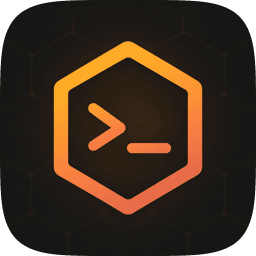
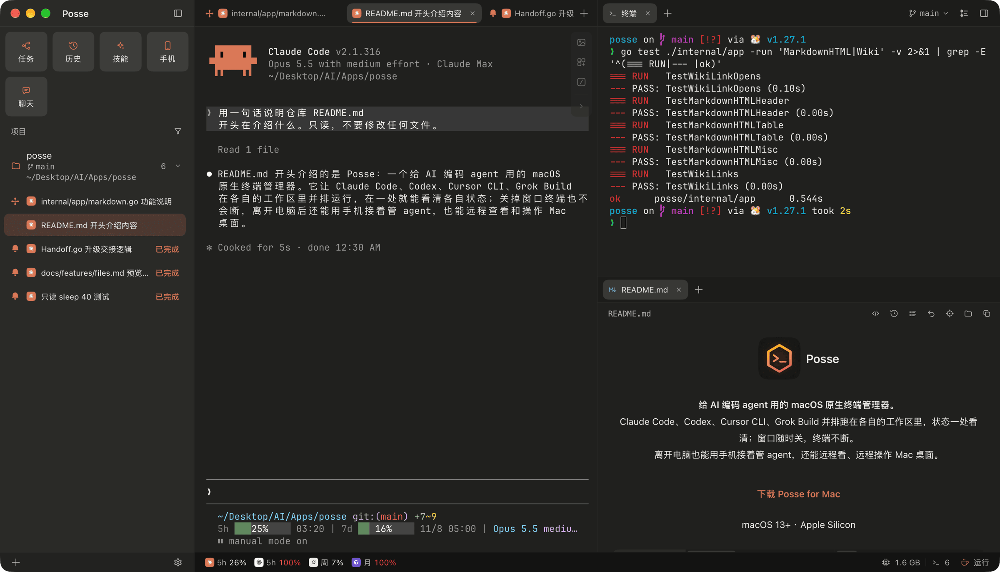
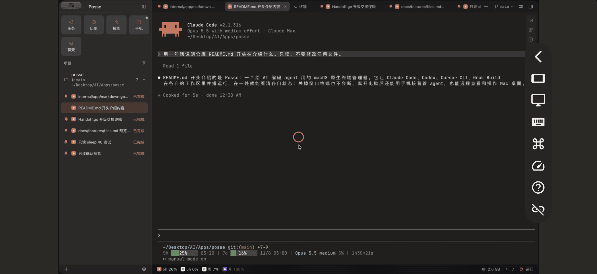
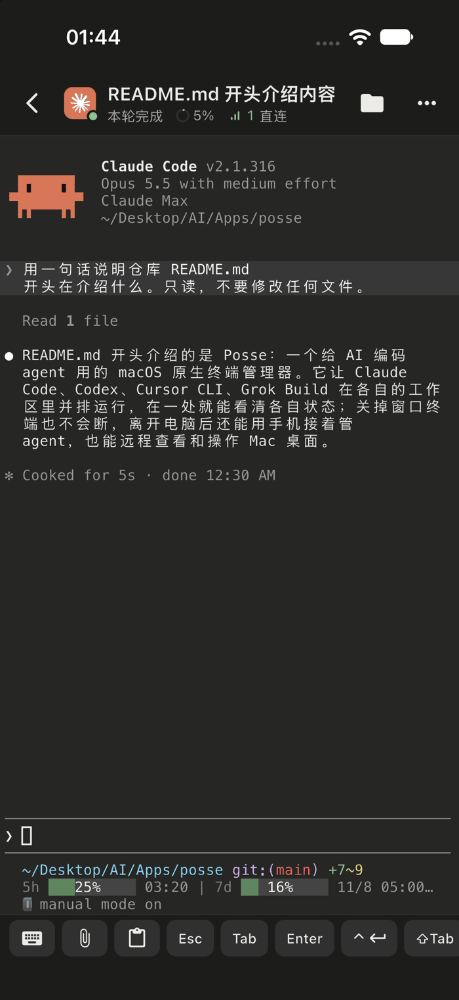
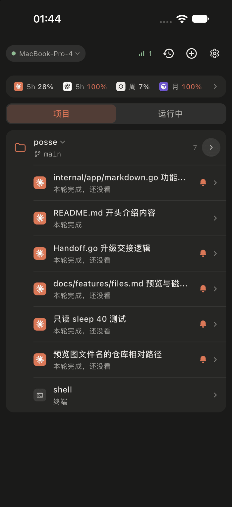
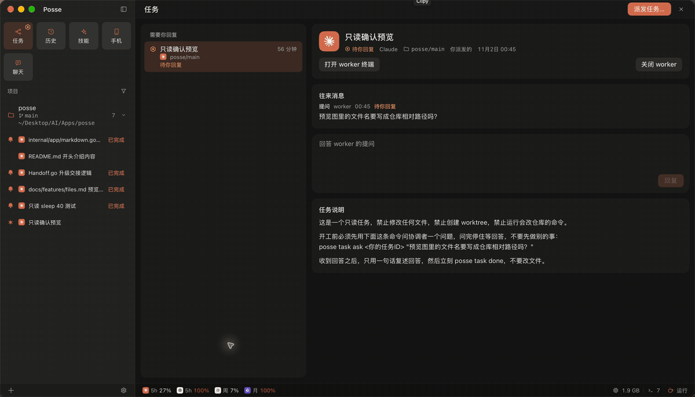
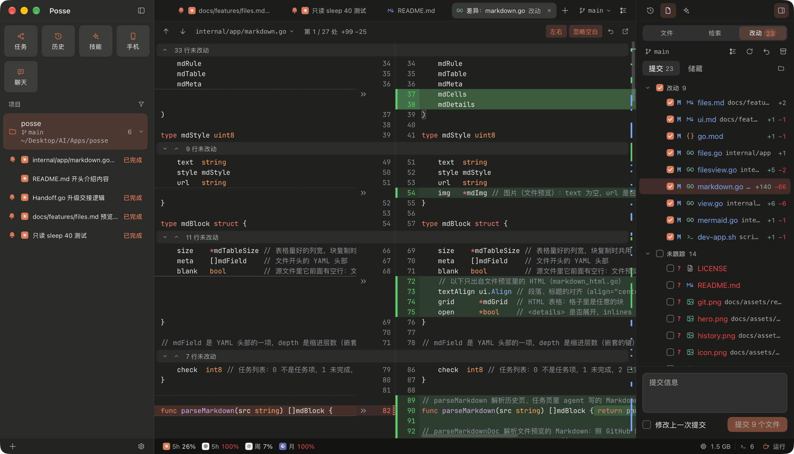
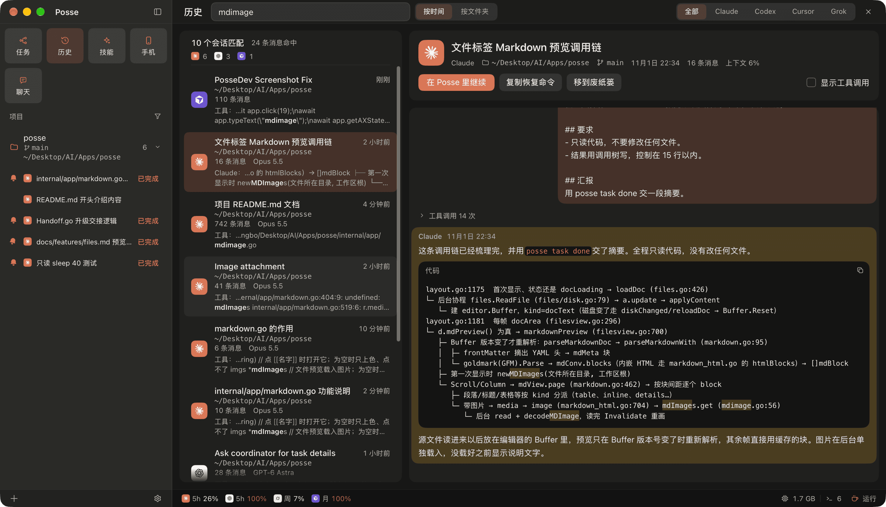
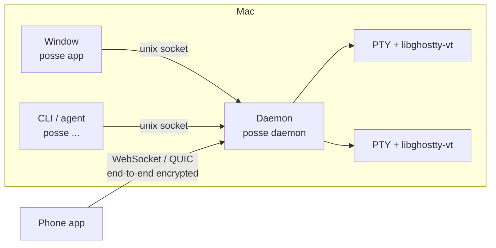

<h1 align="center">
   Posse
</h1>

<p align="center">
  <strong>A native macOS terminal manager for AI coding agents.</strong><br/>
  Run Claude Code, Codex, Cursor CLI and Grok Build side by side and see every status at a glance; keep managing them from your phone when you step away, and even control your Mac desktop remotely.
</p>

<p align="center"><a href="README.md">简体中文</a> · English</p>

<h3 align="center"><a href="https://posse.shaoyan.uk/Posse.dmg">Download Posse for Mac</a></h3>

<p align="center">macOS 13+ · Apple Silicon · ~12 MB download</p>

<p align="center">
  
</p>

## Who it’s for

- **You’re used to Git in JetBrains IDEs (IntelliJ IDEA, WebStorm)**: the Git UI follows WebStorm, so you can review what an agent changed, commit and roll back without opening an IDE.
- **You like terminal tools such as herdr but want a GUI**: a daemon hosts the terminals, so agents keep running when the window is closed, and you get sidebar status, split panes, a file tree and Git on top.
- **You like Orca but not the weight of Electron**: it works the way Orca does, with a native UI that stays light.
- **You don’t want to keep switching between terminal, editor and Git client**: agents, files and Git live in one window; tweak a few lines and save with ⌘S.

## Why Posse

- **Close the window anytime; terminals keep running.** A single Go daemon hosts every terminal. Reopen the window and everything reattaches as it was, and upgrades don’t interrupt running agents.
- **Light.** The window only attaches to terminals you can see, so it doesn’t get heavier as you open more agents. The download is about 12 MB and about 32 MB installed; the UI is drawn natively with [MyGo](https://github.com/egoist/mygo). The memory figure in the screenshot’s status bar is Posse plus the programs in its terminals (agents, MCP servers and so on).
- **Leaves your agent config alone.** Status comes from hooks injected at launch; nothing is written into the hooks in `~/.claude` or `~/.codex`.

## Features

<table>
<tr>
<td width="38%" valign="middle">

### Remote desktop from your phone

View and control your Mac desktop from your phone: trackpad gestures and ⌘ shortcuts work, you can watch a single window, and you can type your password to unlock a locked screen. When the network gets worse it lowers the bitrate instead of breaking up.

</td>
<td width="62%"></td>
</tr>
<tr>
<td width="38%" valign="middle">

### Keep managing agents from your phone

Check session status, type into terminals, send images and files, approve Claude’s permission requests, and browse history and Git changes. Connects directly over the LAN or Tailscale, or through a relay you deploy yourself when away (see [`docs/features/mobile.md`](docs/features/mobile.md)), with end-to-end encryption.

Most of Posse itself was built by its author handing work to agents from a phone, on the go.

</td>
<td width="62%"> </td>
</tr>
<tr>
<td width="38%" valign="middle">

### Multi-agent orchestration

Use `posse task` to hand work to other agents, with a chosen model and optionally in its own worktree; when a worker asks a question, answer it right in the Tasks page. Send the same research to several agents and compare their conclusions for a fuller picture.

</td>
<td width="62%"></td>
</tr>
<tr>
<td width="38%" valign="middle">

### Git, modeled on WebStorm

Changes, side-by-side diffs, commit, rollback, stash, branch compare, Annotate and conflict resolution all live in the window; review a worktree’s changes and merge it right away.

</td>
<td width="62%"></td>
</tr>
<tr>
<td width="38%" valign="middle">

### Session history

Full-text search across sessions from all four agents; pick one and continue it in a new terminal.

</td>
<td width="62%"></td>
</tr>
</table>

Also: arbitrarily nested split panes, completion alerts and Dock badges, quick chats with ⇧⌘N, skill and MCP management, GitHub-style Markdown preview, web tabs for agents, plan usage and Prevent Sleep. See [`docs/features/`](docs/features) for details (in Chinese).

## Install

**Mac**: download [Posse.dmg](https://posse.shaoyan.uk/Posse.dmg) and drag it into Applications; it updates itself from then on.

**Android**: open <https://posse.shaoyan.uk/android/index.html> in your phone’s browser to download and install.

**iOS**: not on the App Store yet, so build and install it on your iPhone yourself (Xcode, [fvm](https://fvm.app) and Go; a free Apple ID is enough):

1. Open `mobile/ios/Runner.xcworkspace` in Xcode and change the signing Team and Bundle Identifier to your own. Push notifications need a paid developer account:
   - Paid account: change the notification extension `PushService` to `<your ID>.PushService`, and the App Group of both targets to `group.<your ID>` (the code uses `group.com.neolabsapp.posse.mobile` in `PushPlugin.swift` and `NotificationService.swift`; change those too).
   - Free Apple ID: push isn’t available. In the `Runner` target’s Signing & Capabilities, remove Push Notifications and App Groups, then delete the `PushService` target from the target list. Everything else works; you just won’t get notifications.
2. Connect the iPhone to the Mac, turn on Developer Mode, then:

   ```sh
   cd mobile && fvm install && fvm flutter run --release
   ```

3. On first launch, trust the developer in Settings › General › VPN & Device Management. Apps signed with a free account must be reinstalled after 7 days.

Once the phone app is installed, click Mobile in the Mac sidebar and scan the code to pair.

## Getting started

1. Click **+** at the bottom left to add a project folder, then create a workspace (the project folder itself, or a new git worktree).
2. Start an agent session in the workspace; typing `claude` or `codex` directly in a Posse terminal is recognized too.
3. Terminals come with the `posse` command, for you and for agents alike; run `posse --help` to see everything:

```sh
posse workspace create myapp feat-login --mode worktree --agent claude --prompt "Add a remember-me option to the login page"
posse task start --agent codex "Reproduce and fix the nil pointer at startup"   # agents hand work to each other; read posse task guide first
posse history search "reconnect"
```

| Supported agent | Where status comes from | Approve permissions on phone |
| --- | --- | --- |
| [Claude Code](https://github.com/anthropics/claude-code) | hooks | ✓ |
| [Codex](https://github.com/openai/codex) | hooks | — |
| [Cursor CLI](https://cursor.com/cli) | hooks | — |
| [Grok Build](https://docs.x.ai/build/overview) | terminal title | — |

## How it works



A single `posse` binary is the window, the daemon and the CLI. The daemon owns every terminal, and the window and the phone are just its clients; on upgrade the old and new daemons hand the terminals over without interruption.

## Build from source

You need Go (version in `go.mod`, downloaded automatically) and Xcode. In mainland China, set `export GOPROXY=https://goproxy.cn,direct` first.

```sh
git clone https://github.com/syanbo/posse.git && cd posse
go build -o bin/posse ./cmd/posse
go tool mygo build -platform darwin/arm64 -skip-dmg -sign - -skip-notarize   # package Posse.app with an ad-hoc signature
```

Ad-hoc signed builds don’t check for updates, and the official release won’t replace them in Applications. For the phone app, see [`mobile/README.md`](mobile/README.md).

Architecture and development conventions are in [`AGENTS.md`](AGENTS.md), and how each feature behaves is in [`docs/features/`](docs/features) (both in Chinese). See [`CONTRIBUTING.md`](CONTRIBUTING.md) to contribute and [`SECURITY.md`](SECURITY.md) to report a security issue.

## Acknowledgments

- [MyGo](https://github.com/egoist/mygo): the native UI framework.
- [Ghostty](https://github.com/ghostty-org/ghostty): libghostty-vt, the terminal core.
- [Orca](https://github.com/stablyai/orca): much of the interaction follows it, and the phone side is compatible with its app.
- [Pele](https://github.com/obsidianmd/pele), [Mayoi](https://github.com/sorrycc/Mayoi): Mermaid diagram layout and how it’s wired in.
- [Alma](https://alma.now): sending encrypted messages between phone and Mac as binary frames is modeled on its remote connection protocol.
- The agents that build Posse alongside: [Claude Code](https://github.com/anthropics/claude-code), [Codex](https://github.com/openai/codex), [Cursor CLI](https://cursor.com/cli), [Grok Build](https://docs.x.ai/build/overview).

## License

[MIT](LICENSE). The name “Posse” and its icon are not licensed with the code; if you publish a modified version, please use a different name and icon.
