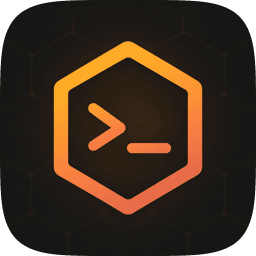
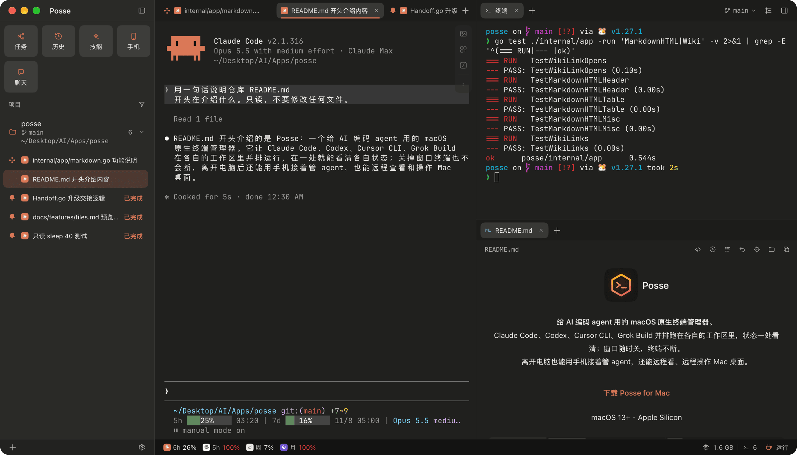
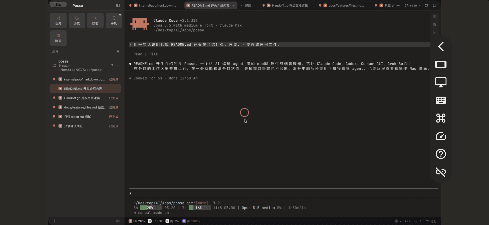
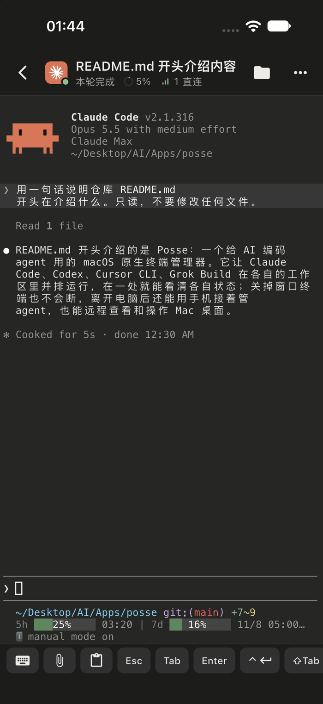
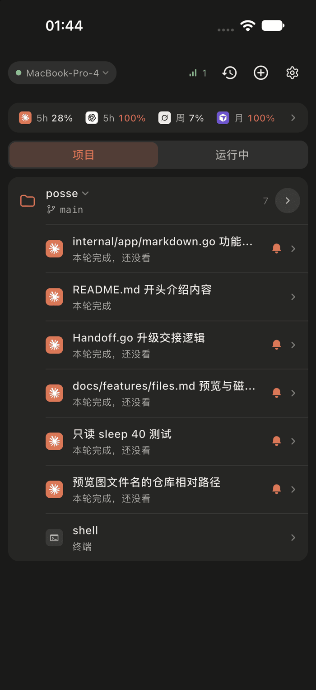
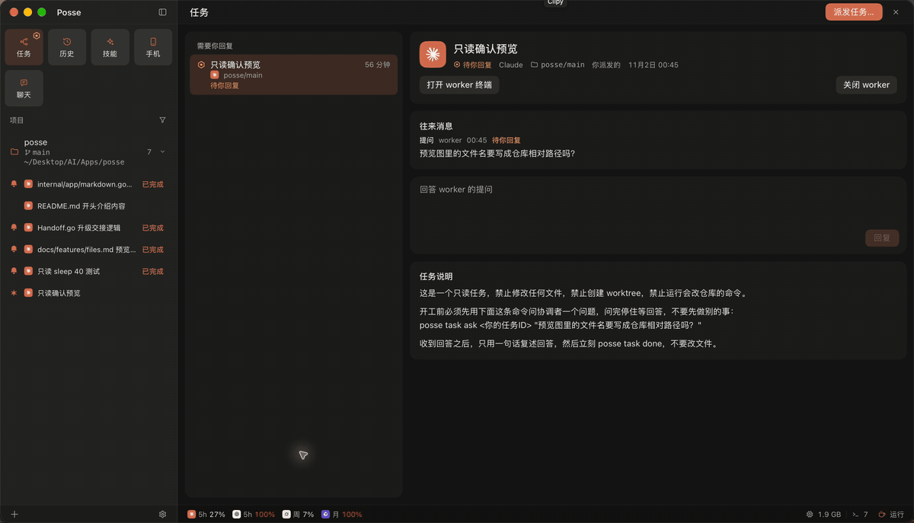
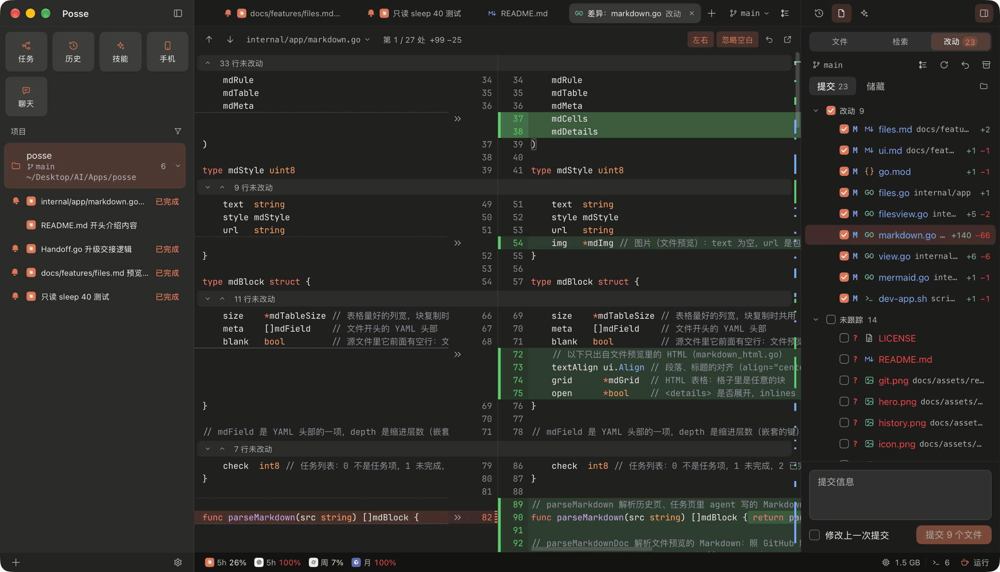
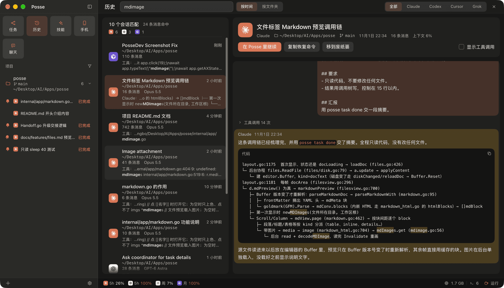
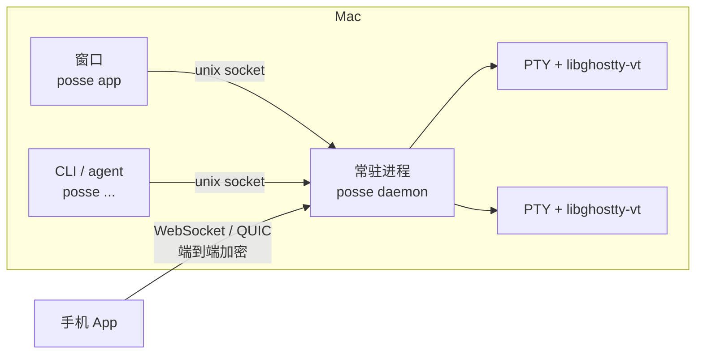

<h1 align="center">
   Posse
</h1>

<p align="center">
  <strong>给 AI 编码 agent 用的 macOS 原生终端管理器。</strong><br/>
  Claude Code、Codex、Cursor CLI、Grok Build 并排干活，状态一处看清；离开电脑用手机接着管，还能远程操作 Mac 桌面。
</p>

<p align="center">简体中文 · <a href="README.en.md">English</a></p>

<h3 align="center"><a href="https://posse.shaoyan.uk/Posse.dmg">下载 Posse for Mac</a></h3>

<p align="center">macOS 13+ · Apple Silicon · 安装包约 12 MB</p>

<p align="center">
  
</p>

## 适合谁

- **用惯了 JetBrains（IDEA、WebStorm）的 Git**：Git 界面照 WebStorm 做，看 agent 改了什么、提交、回滚都不用再开 IDE。
- **喜欢 herdr 这类终端工具，但想要图形界面**：常驻进程托管终端，关掉窗口 agent 照跑，多了侧栏状态、分栏、文件树和 Git。
- **喜欢 Orca，但受不了 Electron 的笨重**：用法照 Orca 来，换成原生界面，用起来更轻。
- **不想在终端、编辑器、Git 客户端之间来回切**：agent、文件、Git 一个窗口搞定，顺手改几行文件 ⌘S 保存。

## 为什么是 Posse

- **窗口随时关，终端不断。** 所有终端由一个 Go 常驻进程托管，重开窗口原样接上，升级也不打断正在跑的 agent。
- **轻。** 窗口只接入看得见的终端，开再多 agent 也不跟着变重；安装包约 12 MB，装好约 32 MB，界面用 [MyGo](https://github.com/egoist/mygo) 原生自绘。截图底栏的内存数是 Posse 加上各终端里程序（agent、MCP 等）的合计。
- **不碰你的 agent 配置。** 状态靠启动时注入的 hooks 拿到，不往 `~/.claude`、`~/.codex` 的配置里写 hooks。

## 特性

<table>
<tr>
<td width="38%" valign="middle">

### 手机远程桌面

在手机上看并操作 Mac 桌面：触控板手势、⌘ 组合键都能用，可以只看某一个窗口，锁屏时也能输密码解锁；网络变差时自动降码率，不花屏。

</td>
<td width="62%"></td>
</tr>
<tr>
<td width="38%" valign="middle">

### 手机上接着管 agent

看会话状态、进终端发指令、发图片和文件、批准 Claude 的权限请求，也能翻历史和 Git 改动。局域网、Tailscale 直连，外网经你自己部署的中转（见 [`docs/features/mobile.md`](docs/features/mobile.md)），端到端加密。

Posse 自己的大部分功能，就是作者在手机上随时随地给 agent 派活做出来的。

</td>
<td width="62%"> </td>
</tr>
<tr>
<td width="38%" valign="middle">

### 多 agent 编排

用 `posse task` 把活派给别的 agent，可以指定模型、放进独立的 worktree；worker 提问时你在任务页直接回答。同一个调研派给几家 agent 分头做，对照结论更全面。

</td>
<td width="62%"></td>
</tr>
<tr>
<td width="38%" valign="middle">

### 照 WebStorm 做的 Git

改动、左右对照 diff、提交、回滚、储藏、分支比较、Annotate、冲突处理都在窗口里，worktree 的改动看完就能合。

</td>
<td width="62%"></td>
</tr>
<tr>
<td width="38%" valign="middle">

### 会话历史

四家 agent 的会话全文搜索，选中后在新终端里接着聊。

</td>
<td width="62%"></td>
</tr>
</table>

还有：任意嵌套的分栏、完成提醒和 Dock 角标、⇧⌘N 临时聊天、技能与 MCP 管理、照 GitHub 渲染的 Markdown 预览、给 agent 用的网页标签、套餐用量和防休眠。各功能的细节见 [`docs/features/`](docs/features)。

## 安装

**Mac**：下载 [Posse.dmg](https://posse.shaoyan.uk/Posse.dmg)，拖进「应用程序」，之后自动更新。

**安卓**：手机浏览器打开 <https://posse.shaoyan.uk/android/index.html> 下载安装。

**iOS**：还没上架，需要自己编译装到 iPhone（Xcode、[fvm](https://fvm.app)、Go，免费 Apple ID 也行）：

1. 用 Xcode 打开 `mobile/ios/Runner.xcworkspace`，把签名的 Team 和 Bundle Identifier 换成你自己的。推送通知要付费的开发者账号：
   - 付费账号：通知扩展 `PushService` 的 Bundle Identifier 换成 `<你的 ID>.PushService`，两个 target 的 App Group 换成 `group.<你的 ID>`（代码里的 `group.com.neolabsapp.posse.mobile` 在 `PushPlugin.swift`、`NotificationService.swift`，一起改）。
   - 免费 Apple ID：开不了推送。在 `Runner` target 的 Signing & Capabilities 里删掉 Push Notifications 和 App Groups，再在 target 列表里删掉 `PushService`。App 照常能用，只是收不到通知。
2. iPhone 连上 Mac、打开开发者模式，然后：

   ```sh
   cd mobile && fvm install && fvm flutter run --release
   ```

3. 首次打开在「设置 › 通用 › VPN 与设备管理」里信任开发者。免费账号签的 App 7 天后要重装。

手机装好后，在 Mac 侧栏点「手机」扫码配对。

## 快速上手

1. 点左下角 **+** 添加项目目录，新建工作区（项目目录本身，或一个新的 git worktree）。
2. 在工作区里新建 agent 会话；在 Posse 终端里直接敲 `claude`、`codex` 也一样认得出来。
3. 终端里自带 `posse` 命令，人和 agent 都能用，`posse --help` 看全部：

```sh
posse workspace create myapp feat-login --mode worktree --agent claude --prompt "给登录页加上记住密码"
posse task start --agent codex "复现并修复启动时的空指针"   # agent 之间派活，先看 posse task guide
posse history search "重连"
```

| 支持的 agent | 状态从哪来 | 手机上批权限 |
| --- | --- | --- |
| [Claude Code](https://github.com/anthropics/claude-code) | hooks | ✓ |
| [Codex](https://github.com/openai/codex) | hooks | — |
| [Cursor CLI](https://cursor.com/cli) | hooks | — |
| [Grok Build](https://docs.x.ai/build/overview) | 终端标题 | — |

## 工作方式



一个 `posse` 二进制同时是窗口、常驻进程和 CLI。常驻进程持有所有终端，窗口和手机都只是它的客户端；升级时新旧常驻进程交接终端，不中断。

## 从源码构建

需要 Go（版本见 `go.mod`，会自动下载）和 Xcode；国内网络先设 `export GOPROXY=https://goproxy.cn,direct`。

```sh
git clone https://github.com/syanbo/posse.git && cd posse
go build -o bin/posse ./cmd/posse
go tool mygo build -platform darwin/arm64 -skip-dmg -sign - -skip-notarize   # 临时签名打包 Posse.app
```

临时签名的包不检查更新，装进「应用程序」也不会被官方版本换掉。手机端的构建见 [`mobile/README.md`](mobile/README.md)。

架构和开发约定见 [`AGENTS.md`](AGENTS.md)，各功能的行为见 [`docs/features/`](docs/features)，参与开发见 [`CONTRIBUTING.md`](CONTRIBUTING.md)，安全问题见 [`SECURITY.md`](SECURITY.md)。

## 致谢

- [MyGo](https://github.com/egoist/mygo)：原生界面框架。
- [Ghostty](https://github.com/ghostty-org/ghostty)：终端内核 libghostty-vt。
- [Orca](https://github.com/stablyai/orca)：很多交互照它来，手机端兼容它的 App。
- [Pele](https://github.com/obsidianmd/pele)、[Mayoi](https://github.com/sorrycc/Mayoi)：Mermaid 图的排版和接入方式。
- [Alma](https://alma.now)：手机和电脑之间的加密消息改用二进制帧传输，参考了它的远程连接协议。
- 一起开发 Posse 的 agent：[Claude Code](https://github.com/anthropics/claude-code)、[Codex](https://github.com/openai/codex)、[Cursor CLI](https://cursor.com/cli)、[Grok Build](https://docs.x.ai/build/overview)。

## 许可

[MIT](LICENSE)。「Posse」名称和图标不随代码授权，发布修改版请换用别的名称和图标。
