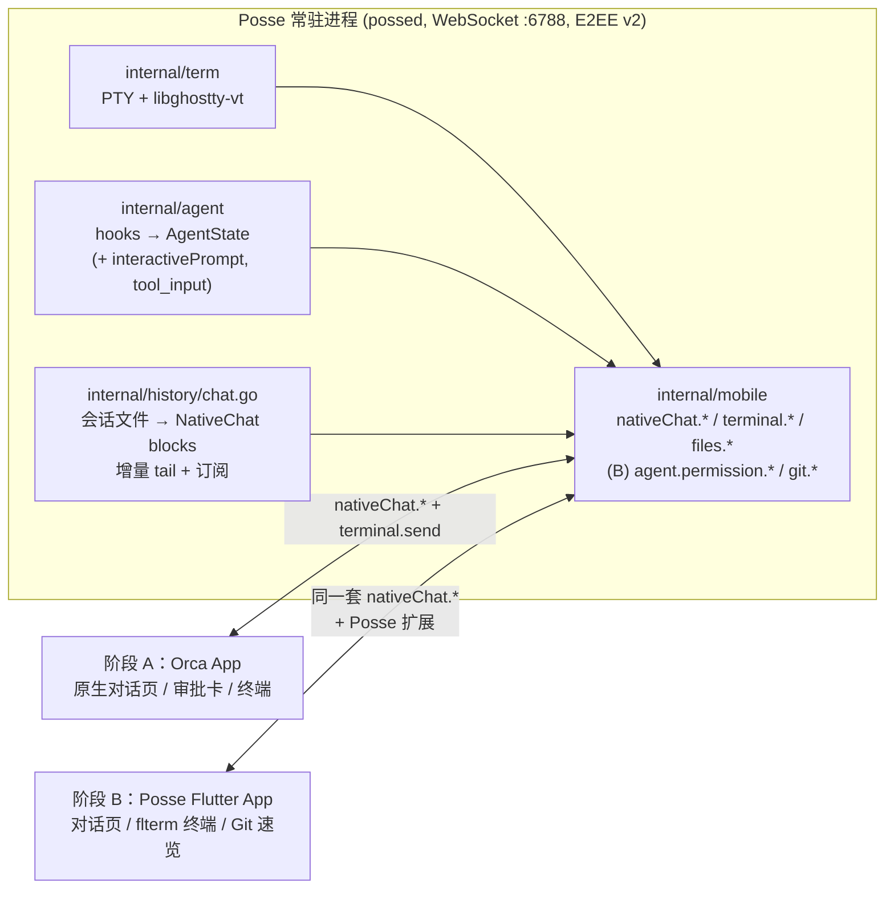
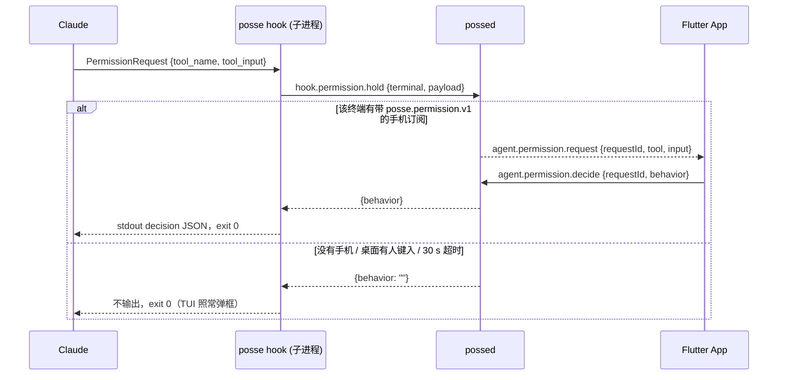

# Posse 移动端方案：先兼容 Orca 原生对话协议，再做 Flutter 客户端

## 1. 结论与路线

目标不变：手机上以结构化对话为主、原生终端为辅地遥控 Posse 里的 agent，不用 WebView。路线改成两个阶段：

| 阶段 | 做什么 | 客户端 | 目的 |
| :-- | :-- | :-- | :-- |
| A | Posse 常驻进程实现 Orca 的 `nativeChat.*` 协议，补齐 agent 状态行里手机要的字段 | 现有 Orca App（iOS / Android） | 不写一行客户端代码就能验证"结构化对话 + 审批卡片"是否够用，协议顺带定稿 |
| B | Flutter 客户端，复用阶段 A 的协议，再加 Posse 自己的扩展（hook 审批决策、多地址竞速、Git 速览） | 自研，iOS 先、Android 后期 | 摆脱 Orca App 的节奏和 UI 限制，拿到 120Hz 原生终端和多地址无感切换 |

改动路线的依据（2026-10-17 核对 Orca 仓库 `stablyai/orca` main 分支）：

- Orca 手机端不是"纯 WebView 终端"。它已有原生对话页（`mobile/src/session/MobileNativeChat*.tsx`）、AskUserQuestion 原生答题卡、权限审批卡、agent 历史面板、diff 审阅，协议是 `nativeChat.readSession / subscribe / unsubscribe` 加 `terminal.send`。Posse 服务端缺的只是这几个方法和状态行里的两个字段。
- 原方案里的 `agent.chat.*` 和 Orca 的 `nativeChat.*` 解决同一件事，再造一套没有收益。阶段 B 的 Flutter 客户端直接讲 `nativeChat.*`，Posse 扩展另起名字，服务端只维护一套对话协议。
- 审批靠注入 `\x1b[B\r` 这类按键不可靠（Claude 的权限菜单选项数量随情形变化）。Orca 的做法是只发数字 `1` 允许、Esc 拒绝、不带回车，并用 `interactivePrompt` 把提示内容原样推给手机；Posse 阶段 A 照做，阶段 B 再用 Claude Code 的 PermissionRequest hook 返回决策。
- 终端 FFI 不从零写：pub.dev 已有 `flterm`、`libghostty`、`ghostty_vte` 三个基于 libghostty-vt 的 Dart 包，先评估再决定是否自写 Painter。

## 2. 原方案的核对结果

| 原方案的说法 | 核对结果 | 处理 |
| :-- | :-- | :-- |
| 复用 `Terminal.TranscriptPath()` 定位会话文件 | 不存在。实际是 `term.AgentState.TranscriptPath`（hooks 报上来的）加 `history.TranscriptPath(agent, sessionID, reported)` 兜底 | 按实际 API 写 |
| 复用 `internal/history` 的解析器直接推结构化消息 | 解析器按行解析可复用，但 `history.Message` 只有 role / text / at，工具调用和输出各截到 3072 字符，没有工具名、callId、结构化 blocks | 新写一层 blocks 解码器，和索引共用 JSON 结构体，不共用 Message |
| Orca 手机端全靠 WebView xterm.js | 不成立，见第 1 节 | 阶段 A 直接用 Orca App |
| `runtime.clientCapabilities.update` 协商扩展 | 现在服务端对它直接回空对象，没记状态 | 阶段 B 记录连接的 `client` / `capabilities`，只影响 Posse 扩展方法 |
| `HoldSize` 会改乱桌面终端宽度 | 属实，`subscribeTerminal` 一接入就按手机 viewport 改尺寸 | 结构化对话不订阅终端，不触发 |
| `third_party/mygo/.../render.go` 的 RenderState C API | 存在，posse 的 `internal/vt` 只在测试里加载它 | 阶段 B 自写 Painter 时才用 |
| libghostty-vt 交叉编译 iOS / Android | Ghostty 该 commit 的 `GhosttyLibVt.zig` 检测到 iOS SDK 时自动打 ios 和 ios-simulator 切片进 xcframework；Android 没有官方目标，第三方用 Zig + NDK 加 `-Dsimd=false` 编过并需 patchelf 改 SONAME；本机没装 Zig | iOS 可行；Android 放后期 |
| 审批动作 `\x1b[B\r` 等按键表 | 不可靠 | 改成 Orca 的数字键 / Esc，阶段 B 加 hook 决策 |
| 多地址 `endpoints` 字段 + Happy Eyeballs | Orca 的 `pairing.getEndpoints` 返回的是云端 relay / install 信息，不是局域网地址列表；Orca App 对配对码未知字段的容忍度未核实 | 阶段 A 不碰配对码；阶段 B 自研客户端再做 |
| Claude 流式回复实时推送 | Claude 的会话文件在一轮回复结束时才写 assistant 记录，手机只能看到"工作中"和整段结果；Orca 的原生对话同样如此 | 接受，终端视图兜底 |
| 工期 9 天 | 没算 E2EE 的 Dart 侧对齐、两端签名打包、Android 构建链、Message 结构扩展 | 见第 6 节 |

本机工具链：Flutter 3.47.7、Dart 3.13.5（fvm 固定在 `mobile/.fvmrc`，不改全局 `fvm default`）、Xcode 27.1（iOS SDK 27.1）、Android SDK 已装，Zig 未装。iOS 最低版本随 3.47 升到 15。

## 3. 整体架构



两种客户端讲同一套对话协议，服务端不区分；Posse 扩展方法只有 Flutter 客户端调用，Orca App 不知道也不受影响。

## 4. 阶段 A：服务端实现 Orca 原生对话协议

以下协议形状全部从 Orca 源码和 `mobile/rpc-foundation/goldens` 反推，标注"推断"的是源码里没直接看到、按行为推出来的。

### 4.1 状态行补字段（`worktree.ps` / `session.tabs.*` 的 `agentStatus`）

Orca App 决定一个终端标签能不能开原生对话（`mobile-native-chat-eligibility.ts`）的条件：`type === 'terminal'`，`agentStatus.agentType`（没有则 `launchAgent`）属于支持列表，会话 ID 取 `agentStatus.providerSession.id`，会话文件取 `agentStatus.providerSession.transcriptPath`。支持列表里和 Posse 有交集的是 claude、codex、grok；cursor 不在列表里，只能用终端视图。grok 要求本地可读会话文件，Posse 是本机直连，满足。

`agentRow`（`internal/mobile/methods.go`）要补：

```jsonc
{
  "state": "working | waiting | done",         // 已有；Orca 还有 blocked，Posse 不用
  "agentType": "claude",                       // 已有
  "providerSession": {                          // 新增：没有会话 ID 时整个省略，App 显示等待
    "key": "session_id",
    "id": "<AgentState.SessionID>",
    "transcriptPath": "<AgentState.TranscriptPath，hooks 没报就省略>"
  },
  "toolName": "Bash",                           // 新增：waiting 时的工具名（已在 AgentState.Message 里，拆出来）
  "interactivePrompt": "<JSON 字符串>",         // 新增：见下
  "lastAssistantMessage": "..."                 // 已有
}
```

`interactivePrompt` 是 JSON 字符串，两种形状（`src/shared/agent-hook-listener/interactive-tool.ts`）：

- AskUserQuestion：PreToolUse 的 `tool_input` 原样，即 `{"questions":[{"question","header","multiSelect","options":[{"label","description"}]}]}`。App 用它画答题卡。
- 权限请求：`{"approval":{"tool":"Bash","summary":"go test ./..."}}`，`summary` 是命令、路径或 URL 的一行摘要。App 画"Allow Bash?"卡片。

agent 离开等待状态（任何非 waiting 事件）就清掉。这需要 `internal/agent/hooks.go` 的 `hookPayload` 加 `tool_input`，`term.AgentState` 加 `Prompt string`，`mobile.Terminal` 带上 `SessionID`、`TranscriptPath`、`ToolName`、`Prompt`（`internal/daemon/mobile.go` 映射）。daemon 到界面的 RPC 不改，不用重启就能看到的只有新开的 agent 的新字段，因此发布时要重启常驻进程。

### 4.2 `nativeChat.readSession`

请求：

```json
{"method":"nativeChat.readSession","params":{"agent":"claude","sessionId":"<id>","transcriptPath":"<可选>","limit":60,"beforeOffset":1200}}
```

- `transcriptPath` 有就直接读；没有按 `history.TranscriptPath(agent, sessionId, "")` 在各家目录里找。找不到返回 `{"code":"not_found"}`，App 会重试（Orca 对尚未落盘的会话文件也是这样处理）。
- `limit` 是消息条数。`beforeOffset` 是上一页返回的字节游标，没有表示读最新的一页。
- 响应：

```json
{"beforeOffset":0,"hasMore":false,"messages":[ /* 见 4.4 */ ]}
```

`beforeOffset` 是这一页第一条消息所在行的文件偏移；`hasMore` 表示它前面还有消息。Orca 桌面端全量读是 `readNativeChatTranscript`，但手机端 RPC（`src/main/native-chat/transcript-tail-reader.ts` 的 `readNativeChatTranscriptTailFile`）是从 `beforeOffset`（首次为文件末尾）按块（`TAIL_CHUNK_BYTES`）**从后往前反向扫描换行符**，只解码凑够 `limit + 1` 条消息就停下，复杂度 $O(\text{limit})$，不需要读整个大文件。Posse 照此实现。

### 4.3 `nativeChat.subscribe` / `nativeChat.unsubscribe`

```json
{"method":"nativeChat.subscribe","params":{"agent":"claude","sessionId":"<id>","transcriptPath":"<可选>","limit":40,"subscriptionId":"claude:<id>:<uuid>","capabilities":{"transcriptPending":1}}}
{"method":"nativeChat.unsubscribe","params":{"subscriptionId":"claude:<id>:<uuid>"}}
```

流式回复沿用 Posse 现有的 `c.stream`：同一个请求 id 上发 `{"id","ok":true,"streaming":true,"result":<frame>}`（Orca App 的 `terminal.subscribe`、`session.tabs.subscribe` 已经这样工作）。**注意退订键的差异**：Posse 现有的 `c.startStream(req.ID)` 以请求的 `req.ID` 为键，但 Orca App 调 `nativeChat.unsubscribe` 传的 `subscriptionId` 是客户端在 `subscribe` 参数里自带的 `"claude:<id>:<uuid>"`（不是 `req.ID`，见 `src/main/runtime/rpc/methods/native-chat.ts`），因此 `nativeChat.subscribe` 必须用 `params.subscriptionId`（为空时退回 `agent + ":" + sessionId`）登记流，同键新订阅替换旧订阅。frame 五种（`mobile-native-chat-stream-frame.ts` 只认这五种，其余忽略）：

| `type` | 字段 | 何时发 |
| :-- | :-- | :-- |
| `snapshot` | `messages`, `hasMore`, `beforeOffset`, 可选 `pending: true`, 可选 `error` | 订阅后立刻发最后 `limit` 条；会话文件还没出现时发 `messages: []`, `pending: true`（客户端声明了 `transcriptPending` 才发）；文件被截短（压缩、重写）后重发 |
| `appended` | `messages` | 文件尾部新增了完整行并解出新消息 |
| `replacement` | `messages`, `hasMore` | 整窗替换；Posse 只在文件变短又变长时用，平时不发 |
| `error` | `message` | 读文件出错 |
| `end` | 无 | 服务端主动结束（终端关闭、常驻进程退出）；客户端视为流断开 |

客户端按 `id` 合并消息（`src/shared/native-chat-merge.ts` 的 `applyIncoming`）：已存在的 `id` 在 `source` 优先级不低于旧条目时**原地替换**（`list[at] = message`），新 `id` 追加在末尾，因此同一条消息可以安全地重复发。

监听方式照 Posse 的习惯不用 fsnotify：每个订阅每 500 ms stat 一次文件（size/inode/mtime），变了就从上次偏移接着读完整行；加一条捷径，终端的 `AgentState` 变化（hooks 事件）时立即读一次。文件没出现时按 500 ms 起步、翻倍到 5 s 的间隔找；size 变小视为重写，从头读并发 `replacement`。手机不在线时没有任何轮询。

`lifecycle` 字段（Orca 在 frame 里附的 working / completed / interrupted）Posse 不发：已核实 `mobile-native-chat-stream-frame.ts` 的 `MobileNativeChatStreamFrame` 根本不读 `lifecycle`，App 的工作中状态来自 `agentStatus.state`。

### 4.4 消息与块的形状（`src/shared/native-chat-types.ts`）

```jsonc
{
  "id": "<uuid 或 line-<offset>>",
  "role": "user | assistant | tool | reasoning | system",
  "blocks": [
    {"type":"text","text":"..."},
    {"type":"tool-call","name":"Bash","input":{...},"callId":"toolu_..."},
    {"type":"tool-result","output":"...","isError":false,"callId":"toolu_..."},
    {"type":"image-ref","path":"/tmp/x.png"}            // 或 "url"
  ],
  "timestamp": 1760684100000,                            // 毫秒；没有时 null
  "source": "transcript",
  "parentId": "<上一条的 uuid，可选>",
  "transcriptOffset": 1200                               // 该行的文件偏移，可选
}
```

各家解码规则，从 Orca 的 `transcript-line-decoders-*.ts` 和 `transcript-record-blocks.ts` 抄过来，和 `internal/history/agents.go` 里的过滤规则并存：

- Claude：只认 `type` 为 user / assistant 的行；`id` 取 `uuid`，再退到 `message.id`，再退到 `line-<offset>`；`timestamp` 解析 ISO 时间。content 块：text→text，thinking→text 且整条消息 role 记 `reasoning`（Orca 这里有个注释和实现不一致，Posse 按注释做），tool_use→tool-call（`name`、`input` 原样、`callId` = `id`），tool_result→tool-result（content 数组按 text 拼成 `output`，`is_error`），image→image-ref；redacted_thinking、document 丢弃。user 行若全是 tool-result 则 role 为 `tool`。`isMeta` / `isSynthetic` / `isCompactSummary` 的 user 行只保留 tool-result 块和图片路径标记，其余丢掉。被中断的回复（Claude 写入的 "[Request interrupted by user]" 文案）换成 `role: system` 的中断提示。`toolUseResult.structuredPatch` 可附成 `editPatch`（阶段 A 不做）。
- Codex：`response_item` 的 message（user 块里以 `<skill>` 开头的丢掉）、reasoning（`role: reasoning`）、function_call / local_shell_call / custom_tool_call（tool-call，`input` 取 `arguments`、`input` 或 `action`）、function_call_output / custom_tool_call_output（tool-result）；`event_msg` 的 user_message、agent_message、item_completed（新格式）、turn_aborted（system 中断提示）；`id` 取 payload 或 item 的 `id`。
- Grok：按 `chat_history.jsonl` 解，时间从 `updates.jsonl` 对（复用 `internal/history` 已有的对齐逻辑），工具调用没有结构化参数时 `input` 放 `{"text": ...}`。

截断（照 Orca 的 `src/main/runtime/rpc/methods/native-chat-rpc-block-sanitize.ts`）：
- `text` 块上限 **64,000 字符**（`MOBILE_TEXT_BLOCK_CHAR_CAP`）；
- `tool-result` 的 `output` 上限 **4,000 字符**（`MOBILE_BLOCK_CHAR_CAP`），超出补 `"\n… (truncated)"`；
- `tool-call` 的 `input` 递归限制 **最多 20 个键/元素、深度 5、总字符预算 4,000**（防止 `Write` / `Edit` 工具调用把整份大文件内容塞进 `input` 撑爆单帧）。

实现位置：`internal/history/chat.go`（解码器和订阅器）+ `internal/mobile/chat.go`（RPC 分发）。解码器和索引共用 `claudeRecord`、`codexRecord`、`scanLines`、`splitCJK` 之外的工具函数，不共用 `Message` 和 `parserVersions`。

### 4.5 `terminal.send` 的返回与审批按键

Orca App 发对话消息、答题、审批都走 `terminal.send`，参数 `{terminal, text, enter, requireWriteSettlement?, client?}`（`mobile-native-chat-send.ts`）。审批时 `enter: false`，`text` 是 `1`（Claude / Codex 允许）或 `\x1b`（拒绝）；AskUserQuestion 的答案由 App 拆成多组按键，每组一次 `terminal.send`，组间 500 ms（`native-chat-answer-stepping.ts`），服务端不用做任何事。

`requireWriteSettlement: true` 时 App 读返回里的 `send.writeSettlement.outcome`（accepted / refused）和 `send.accepted`；缺这些字段就显示"未确认，先看聊天再重试"。Posse 的 `sendInput` 要在返回里加：

```json
{"send":{"accepted":true,"writeSettlement":{"outcome":"accepted"}}}
```

PTY 写入失败时 `accepted: false`、`outcome: "refused"`。现有的"文本和回车分开发、间隔 120 ms"保留。

### 4.6 不在阶段 A 做的

- Orca 的 `agentSession.*`（Orca 自己托管的结构化会话）、`settings.mutateNativeChatSessionOptions`（选模型）、`orchestration.workerTerminalUserInput`：返回 `method_not_found`，App 对这些都有降级。
- 配对码和多地址：维持现状。
- `lifecycle`、`editPatch`、`subagent-group`、`background-task` 块。

### 4.7 验证

- 单元测试：`internal/history/chat_test.go` 用各家会话文件的样例行（`history_test.go` 已有一部分，缺的补）固定解码结果（含截断、中断、isMeta 过滤）；`internal/mobile/server_test.go` 走一遍 subscribe → 追加写文件 → 收到 `appended` → 截短文件 → 收到 `replacement` → unsubscribe。
- 端到端：`POSSE_HOME=/tmp/posse-e2e/home POSSE_MOBILE_PORT=6799 ./bin/posse daemon run`，iPhone 上的 Orca App 配对后在原生对话页看一个 claude 终端：发一条极短任务、触发一次权限提示并在手机上允许、触发一次 AskUserQuestion 并在手机上作答、看 codex 和 grok 各一个会话。检查桌面窗口的终端宽度全程没变。

## 5. 阶段 B：Flutter 客户端

### 5.1 范围与顺序

iOS 先做到可用，Android 后期：Android 的 libghostty-vt 构建链（Zig + NDK，`-Dsimd=false`，patchelf 改 SONAME）要单独维护，先看 `flterm` 等包是否自带 Android 预编译产物再决定自己编还是用现成的。

### 5.2 协议

- 对话：和阶段 A 完全同一套 `nativeChat.*` + `terminal.send` + `worktree.ps` / `session.tabs.subscribe`，服务端零改动。
- 握手后发 `runtime.clientCapabilities.update {client: "posse-flutter", version: 1, capabilities: ["posse.permission.v1", "posse.git.v1"]}`；服务端记在连接上，只有带相应能力的连接才收到下面的扩展推送。
- `agent.permission.*`（hook 决策审批，见 5.3）。
- `git.status {worktree}` / `git.diff {worktree, path}`：方法名借 Orca 的 `git.*` 族，返回结构自定（改动文件列表带增删行数、分支领先 / 落后；统一 diff 文本），复用 `internal/gitx` 的 `status.go` 和 `DiffSummary`，diff 文本照界面的做法用 `runRaw` 调 `git diff`。改动工作目录的 git 操作（checkout、commit、push）不开放给手机。
- 多地址：配对码里加 `endpoints: ["ws://192.168.x.x:6788", "ws://100.x.y.z:6788", "wss://..."]`（保留 `endpoint` 不动），客户端并发握手、先完成 `e2ee_ready` 的胜出、其余取消；网络切换时重跑。已核实 Orca 的 `PairingOfferSchema`（`src/shared/mobile-relay-pairing-offer.ts`）使用普通 `z.object(...)` 而非 `.strict()`，未知字段会被 Zod 自动忽略，不影响 Orca App 扫码。
- 终端视图：`terminal.subscribe` 和二进制帧照旧。

### 5.3 审批走 PermissionRequest hook 决策

Claude Code 的 PermissionRequest hook 可以在 stdout 返回决定（已查 Claude Code hooks 文档）：

```json
{"hookSpecificOutput":{"hookEventName":"PermissionRequest","decision":{"behavior":"allow"}}}
```

`behavior` 是 allow 或 deny，allow 时可带 `updatedInput`；不输出就按正常流程弹 TUI 提示。**注意 Posse 现有的两处硬编码超时**：
1. `internal/agent/agent.go` 的 `claudeSettings()` 目前给所有事件统一写了 `Timeout: 5`（5 秒，覆盖了 Claude 默认的 600 秒）；
2. `internal/cli/commands.go` 的 `cmdHook` 调常驻进程 RPC 时硬编码了 `2 * time.Second` 超时。
因此要支持 30 秒挂起，必须把 `claudeSettings()` 中 `PermissionRequest` 的 `Timeout` 调大到 `40`，并在 `cmdHook` 中对 `PermissionRequest` 事件将 RPC 超时设为 `35 * time.Second`（其余事件仍保持 5s / 2s）。



约束：

- 图里的 `agent.permission.request` 不另开 RPC。有订阅时，载荷写在这条 `nativeChat.subscribe` 流上：`{type:"permission", requestId, terminal, tool, input}`，`input` 是原始 `tool_input`。手机用 `agent.permission.decide {requestId, behavior}` 回应。
- 只在"该终端当前有手机订阅着对话"时才挂起，否则立刻放行，桌面用户感觉不到变化。挂起期间桌面终端一有键入（`Terminal.LastInput` 变化）就立刻放行，TUI 自己弹框。
- `posse hook` 不拉起常驻进程、始终 exit 0 的约定不变；连不上常驻进程就当作无决定。
- Codex 的 hooks 能否返回决定未核实；Cursor、Grok 没有这条路。不支持的 agent 继续用 4.5 的按键方式。
- Orca App 不受影响：它不声明能力，服务端不挂起，TUI 弹框后它发 `1` / Esc 照常工作。

### 5.4 终端视图

评估顺序：`flterm`（带 widget，声明支持 iOS / Android）→ `libghostty`（Dart 绑定，自己画）→ `ghostty_vte`（纯 FFI，需 Zig 0.15 自编或预编译）。验收标准在真机 Profile 模式下：

- `find /` 级别的连续输出 UI 线程每帧 < 4 ms、Raster < 4 ms，不丢帧；
- CJK 与 emoji 宽字符对齐正确，Claude Code、Codex 的 TUI 边框不错位；
- 切后台再回来不白屏，用内存里的终端状态直接画，重连后用 `terminal.subscribe` 的快照重同步。

都不达标再按附录自写 CustomPainter + RowID 行缓存。

### 5.5 其他

- E2EE v2 用 `cryptography` / `pinenacl` 实现，单元测试对齐 `internal/mobile/e2ee_test.go` 的向量。
- 对话页按 `id` 合并消息、按 `beforeOffset` 翻页，和 Orca 客户端的合并规则一致（`snapshot` 与保留窗口不连续时整窗替换）。
- 输入区：底部一体输入区（⌘↩ 概念对应手机的发送键），软键盘上方的专用键横栏（Esc、Tab、⇧Tab、Ctrl+C、方向键）只在终端视图显示。
- 目录：`mobile/`（Flutter 工程）独立于 Go 模块，`lib/protocol`（E2EE、RPC、配对）、`lib/workspace`（工作区与标签）、`lib/chat`（对话页）、`lib/terminal`（终端视图）、`lib/git`。
- Flutter 版本只由 fvm 管。`mobile/.fvmrc` 固定 3.47.7，`.fvm/`（含指向本机 SDK 的符号链接）不进版本库。在 `mobile/` 里用 `fvm flutter` / `fvm dart`。IDE 读 `mobile/.vscode/settings.json` 的 `dart.flutterSdkPath`。不改本机 `fvm default`（其他工程仍是 3.35.7）。

## 6. 详细执行计划与工期

### 6.1 改动与新增文件树

```
posse/
├── internal/
│   ├── term/term.go                 # [A1] AgentState 增加 ToolName、ToolInput、Prompt
│   ├── agent/
│   │   ├── hooks.go                 # [A1] hookPayload 解析 tool_input，生成 interactivePrompt（AskUserQuestion / PermissionRequest）
│   │   └── agent.go                 # [B2] claudeSettings 中 PermissionRequest Timeout 设为 40s
│   ├── cli/commands.go              # [B2] cmdHook 对 PermissionRequest 放宽 RPC 超时至 35s 并输出决策 JSON
│   ├── daemon/
│   │   ├── mobile.go                # [A1] mobile.Terminal 映射 SessionID、TranscriptPath、ToolName、ToolInput、Prompt
│   │   └── terminal.go              # [B2] hook.event 支持挂起等待手机审批决策与桌面键入打断
│   ├── history/
│   │   ├── chat.go          [新增]  # [A3] NativeChatMessage/Block 解码（Claude/Codex/Grok）、反向按块 tail 读取、4000/64000 截断
│   │   └── chat_test.go     [新增]  # [A5] 三家样例行解码、isMeta 过滤、中断转 system、反向翻页游标与截断单测
│   └── mobile/
│       ├── server.go                # [A4] 流表支持按客户端 subscriptionId 登记与退订；[B1] 记录连接 capabilities
│       ├── methods.go               # [A2] agentRow 补 providerSession/toolName/interactivePrompt；sendInput 补 writeSettlement；tabsKey 纳入 prompt 变化
│       ├── chat.go          [新增]  # [A4] nativeChat.readSession / subscribe / unsubscribe 与 500ms stat 增量监听
│       ├── git.go           [新增]  # [B2] git.status / git.diff 只读 RPC
│       └── server_test.go           # [A5] 补充 nativeChat 订阅、追加、截短重写、退订及 writeSettlement 端到端单测
└── mobile/                  [阶段 B，独立于 Go mod；fvm 固定 Flutter 3.47.7]
    ├── .fvmrc                       # {"flutter": "3.47.7"}
    ├── pubspec.yaml
    └── lib/
        ├── protocol/                # [B1] E2EE v2 (X25519+HKDF+secretbox)、多地址 Happy Eyeballs、RPC client
        ├── workspace/               # [B1] 工作区与会话标签列表
        ├── chat/                    # [B1] NativeChat 消息合并器、Markdown/工具块渲染、审批卡与 AskUserQuestion 答题卡
        ├── terminal/                # [B3] flterm / libghostty-vt 终端视图 + 专用键横栏
        └── git/                     # [B2] 改动列表与 diff 预览
```

### 6.2 阶段 A：服务端实现 `nativeChat.*`（3 到 5 天，按依赖顺序推进）

1. **Step A1：Hook 与 `AgentState` 扩展**（`internal/term/term.go`、`internal/agent/hooks.go`、`internal/daemon/mobile.go`）
   - `term.AgentState` 增加 `ToolName string`、`ToolInput string`、`Prompt string`；`SetAgent` 仅在非空时继承 `SessionID` / `TranscriptPath`，`ToolName` / `ToolInput` / `Prompt` 随每次状态切换覆盖（离开 `waiting` 时自动清空）。
   - `agent.hookPayload` 增加 `ToolInput json.RawMessage`：
     - `PreToolUse` 且 `ToolName` 为 `"AskUserQuestion"` 或 `"request_user_input"` 时，`st.Prompt = string(p.ToolInput)`；
     - `PermissionRequest` 且 `ToolName != ""` 时，提取 `command` / `file_path` / `path` / `url` / `pattern`（截断 200 字符）构造 `{"approval":{"tool":p.ToolName,"summary":...}}` 存入 `st.Prompt`，并将摘要写入 `st.ToolInput`。
   - `daemon/mobile.go` 的 `State()` 把 `a.SessionID`、`a.TranscriptPath`、`a.ToolName`、`a.ToolInput`、`a.Prompt` 填入 `mobile.Terminal`。

2. **Step A2：补齐 `agentRow`、`tabsKey` 与 `terminal.send`**（`internal/mobile/methods.go`）
   - `agentRow(t, now)`：
     - `t.SessionID != ""` 时写入 `"providerSession": {"key": "session_id", "id": t.SessionID, "transcriptPath": ...}`（`TranscriptPath` 为空时用 `history.TranscriptPath(t.Agent, t.SessionID, "")` 兜底，仍为空则省略 `transcriptPath` 字段）；
     - 填入 `"toolName": nilIfEmpty(t.ToolName)`、`"toolInput": nilIfEmpty(t.ToolInput)`、`"interactivePrompt": nilIfEmpty(t.Prompt)`。
   - `tabsKey(w)`：拼入 `t.SessionID`、`t.ToolName`、`t.Prompt`，确保刚拿到会话 ID 或弹出审批卡时 `session.tabs.subscribe` 立即推送 `updated`。
   - `sendInput`：返回结构补上 `"writeSettlement": map[string]any{"outcome": "accepted"}`；`t.Send` 失败时返回 `accepted: false`、`outcome: "refused"`。

3. **Step A3：三家会话解码与反向按块尾部读取**（`internal/history/chat.go`）
   - 定义 `ChatMessage`（`ID, Role, Blocks, Timestamp, Source, ParentID, Offset`）与 `ChatBlock`（`text` / `tool-call` / `tool-result` / `image-ref`），不改 SQLite 索引的 `schemaVersion` / `parserVersions`。
   - 单行解码 `decodeChatLine(agent, raw, offset, st)`：
     - Claude：`user` / `assistant` 行，`thinking` → `role: "reasoning"`，`tool_use` → `tool-call`，`tool_result` → `tool-result`（纯 `tool-result` 的 user 行 `role` 为 `"tool"`），`[Request interrupted by user]` → `role: "system"`，`isMeta` / `isCompactSummary` 行只留 `tool-result` 和图片引用。
     - Codex：兼容 `response_item` 与 `event_msg.item_completed`，过滤 `<environment_context>`、`<skill>` 等注入块。
     - Grok：解析 `chat_history.jsonl`，复用 `grokParser.prepare` 从 `updates.jsonl` 对齐毫秒时间戳。
   - 截断 `sanitizeChatBlock`：`text` 64,000 字符上限，`tool-result.output` 4,000 字符上限，`tool-call.input` 深度 5 / 每层 20 项 / 4,000 字符总预算。
   - 反向读取 `ReadChatTail(agent, sessionID, transcriptPath, limit, beforeOffset)`：对 Claude / Codex 从 `beforeOffset`（`<=0` 取文件末尾）按 64 KB 块反向扫描 `\n`，凑够 `limit + 1` 条即停；对 Grok 顺序对齐时间表后切尾窗。

4. **Step A4：`nativeChat.readSession / subscribe / unsubscribe` 与增量监听**（`internal/mobile/chat.go`、`internal/mobile/server.go`）
   - `server.go`：`startStream` / `stopStream` 支持按订阅键（`"chat:" + subKey`，`subKey` 取 `params.subscriptionId`，缺省为 `agent + ":" + sessionId`）登记与退订，发送仍用请求的 `req.ID`。
   - `chat.go`：
     - `nativeChat.readSession`：调 `history.ReadChatTail`，文件未找到返回 `errorf("not_found", ...)`。
     - `nativeChat.subscribe`：文件未创建且声明了 `transcriptPending == 1` 时先发 `pending: true` 的空 `snapshot` 并按 500ms → 5s 退避轮询；文件就绪后发首帧 `snapshot`，此后每 500ms（或对应终端 `Changed()` 触发时）`os.Stat` 一次——`size < offset` 或 `inode` 变化发 `replacement`，`size > offset` 读新增完整行发 `appended`，退出发 `end`。
     - `nativeChat.unsubscribe`：按 `"chat:" + params.SubscriptionID` 停止流（为空时清理该连接下所有 `"chat:"` 前缀的流）。

5. **Step A5：单元测试与真机验收**（`internal/history/chat_test.go`、`internal/mobile/server_test.go`）
   - `go test ./internal/history -run TestChat`：验证三家样例行解码、截断、过滤及反向 `beforeOffset` 分页连续性。
   - `go test ./internal/mobile -run TestNativeChat`：验证 `subscribe` → 追加写入收到 `appended` → 截短重写收到 `replacement` → `unsubscribe` 及 `writeSettlement`。
   - iPhone Orca App 真机连入：验证 Claude / Codex / Grok 原生对话页、权限卡点 Allow/Deny、AskUserQuestion 答题卡多步提交，并确认桌面窗口终端宽度不变。

### 6.3 阶段 B：Flutter 客户端与 Posse 扩展（阶段 A 验收后启动）

1. **Step B1：协议底座与对话页（8 到 10 天）**
   - `mobile/` 工程已用 fvm 固定 Flutter 3.47.7（Dart 3.13.5）。接着用 `cryptography` / `pinenacl` 实现 E2EE v2，单测对齐 `internal/mobile/e2ee_test.go` 向量。
   - 服务端配对码补 `endpoints` 数组，客户端实现多地址 Happy Eyeballs 并发握手与网络切换重连。
   - 实现工作区列表、标签栏、`nativeChat.*` 消息合并器（按 `id` 原地替换与 `beforeOffset` 翻页）、Markdown/工具折叠块、审批卡与 AskUserQuestion 答题卡。

2. **Step B2：Hook 挂起审批与 Git 速览（3 到 4 天）**
   - 服务端：`claudeSettings()` 将 `PermissionRequest` 的 `Timeout` 设为 `40`；`cmdHook` 对 `PermissionRequest` 设 35s RPC 超时并向 stdout 输出决策 JSON；`daemon` 在有带 `posse.permission.v1` 的手机订阅该终端时挂起请求（桌面 `LastInput` 变化或 30s 超时立即放行回退 TUI）。
   - 服务端新增只读 `git.status` / `git.diff`（复用 `internal/gitx`），客户端实现改动文件列表与 diff 抽屉。

3. **Step B3：120Hz 终端视图与打包（4 到 6 天，Android 构建链后期 3 到 5 天）**
   - 在 iPhone 真机 Profile 模式下实测 `flterm` 连续输出帧耗时与 CJK 宽度；达标则直接集成并加软键盘上方专用键横栏，不达标则切附录的 `RenderState` 脏行 FFI + `RowID` 行级 `ui.Picture` 缓存。

## 7. 依据与未核实项

已核实（源码或官方文档）：Orca 手机端技术栈与原生对话模块、`nativeChat.*` 请求与 frame 形状（含 `readNativeChatTranscriptTailFile` 反向按块读与 `native-chat-rpc-block-sanitize.ts` 的 4000/64000 字符截断规则）、`nativeChat.unsubscribe` 按客户端 `subscriptionId` 退订、消息与块类型、`native-chat-merge.ts` 对重复 `id` 的原地替换规则、`MobileNativeChatStreamFrame` 不读 `lifecycle`、各家解码规则、审批按键、`terminal.send` 的参数与确认字段、eligibility 条件、`status.get` 的能力字段用法、`PairingOfferSchema` 对配对码未知字段的 strip 容忍度；Ghostty 的 iOS xcframework 切片；Claude Code PermissionRequest hook 的决策输出及 Posse 现有的 `Timeout: 5` / `2s` RPC 超时限制；pub.dev 上三个 Dart 包的存在与声明平台。

未核实：Codex hooks 能否返回决策；`flterm` 等包在真机上的性能与 CJK 表现。

参考：
- https://github.com/stablyai/orca （`mobile/src/session/`, `src/shared/native-chat-*.ts`, `src/main/native-chat/`, `src/main/ipc/native-chat.ts`, `mobile/rpc-foundation/goldens/`）
- https://code.claude.com/docs/en/hooks （PermissionRequest 决策输出）
- https://github.com/ghostty-org/ghostty/blob/befcdfd2c3a1cb24d9ec886e93c95b2b5daa7028/src/build/GhosttyLibVt.zig
- https://pub.dev/packages/flterm 、https://pub.dev/packages/libghostty 、https://pub.dev/packages/ghostty_vte
- https://github.com/Uzaaft/awesome-libghostty

## 附录：自写终端渲染的备选设计

只有 5.4 的现成包不达标时才用。要点：

- `bridge.c` 导出 `posse_vt_sync_frame(term, render_state, buf)`：一次调用里 `ghostty_render_state_begin_update` → 遍历 row iterator → 只对脏行解 `rowDataCellsRaw` 写进连续缓冲 → `end_update`。每格 16 字节（codepoint、fg、bg、width、flags），每行一条元数据（RowID、dirty、wrapped、cols）。
- Dart 侧 `Pointer.asTypedList` 零拷贝读；`CustomPainter` 以 RowID 为键缓存每行的 `ui.Picture`，未脏的行只换变换矩阵；脏行先合并同底色画 `drawRect`，再按同样式段合成 `Paragraph`。
- 光标、选区单独一层；`RepaintBoundary` 隔开输入区，软键盘弹出不重绘画布。
