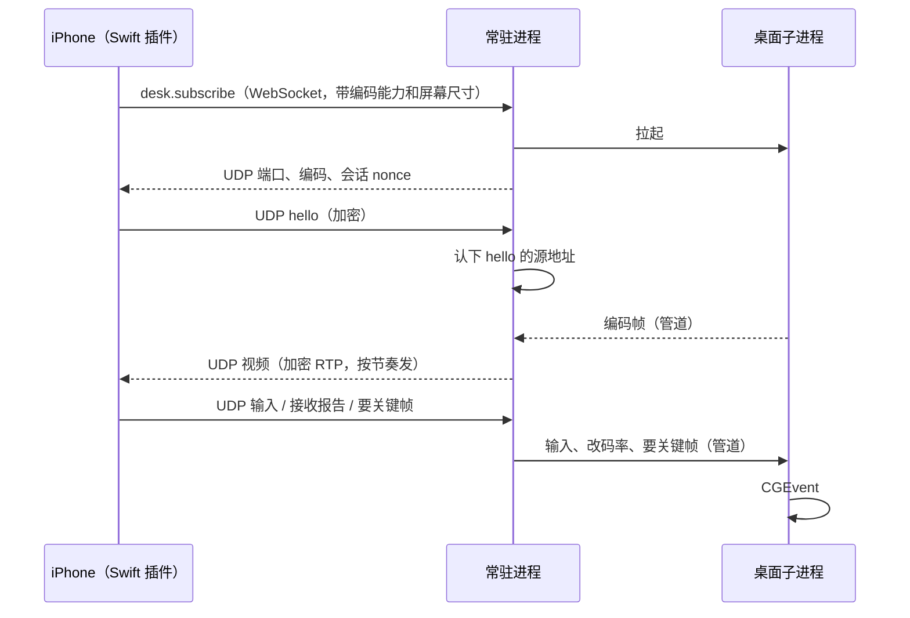

# 手机控制 Mac 桌面

iPhone 看这台 Mac 的主显示器，并发送指针、滚轮和键盘。终端遥控保持原样。配对过的手机就是授权，不再要 Mac 的登录密码。

目标是快和顺：局域网上从手指落下到画面变化尽量短，画面不卡顿、不花屏，弱网时先降码率，不先卡住。

画面自己采集：ScreenCaptureKit 进 VideoToolbox，低延迟码率控制、不用 B 帧，加密后走 UDP 到手机，手机原生层收包、解密、硬解。键鼠也走同一条 UDP。不连系统屏幕共享，不把 Open Screen Sharing 或 Moonlight 的代码引进来。

## 第一版

- 一台已配对的 iPhone，看主显示器整屏（菜单栏所在的那块）。
- 点按、双击、右键、拖动、双指滚动、快捷键和文字。
- 看着的这段时间屏幕不熄。Mac 的手机页能看见是哪一台在看，并能停掉。
- 窗口可以关着。采集挂在常驻进程上。
- 只有 iOS 客户端声明 `hive.desk.v1`，安卓版不显示入口。

分辨率按手机屏幕像素定，长边不超过 1920，宽高取偶数，比例跟主屏一致，缩放由 ScreenCaptureKit 在 GPU 上做。光标画进画面里（直接点按模式下光标就在手指下）。

## 延迟目标

逐段计时，每一帧带采集时刻，手机按校准过的时钟差算出各段耗时。调试开关打开时画面角落显示帧率、码率、丢包、采集到上屏的 p50/p95。

| 段 | 目标 |
| --- | --- |
| 采集（SCK 交出一帧） | ≤ 1 帧 |
| 编码（1920 宽，低延迟码率控制） | p95 ≤ 9 ms：硬件编码器开低延迟码率控制后 p50 约 7–8 ms；关掉能到 4 ms，但帧大小不再被压平 |
| 常驻进程转发、加密 | ≤ 1 ms |
| 网络（5 GHz 局域网） | ≤ 5 ms |
| 解码到上屏 | ≤ 1 个刷新周期 + 解码 |
| 手指到 Mac 画面变化再回到手机（局域网，用 240 帧慢动作拍两块屏实测） | p50 ≤ 70 ms，p95 ≤ 100 ms |

数字是验收线，按第 1–3 步实测修正，不达标不往下走。

## 进程

| 谁 | 做什么 |
| --- | --- |
| 桌面子进程 | 同一个已签名的 Hive 可执行文件（`hive desk helper`），由常驻进程拉起。跑 ScreenCaptureKit、编码器和 CGEvent 注入，屏幕录制和辅助功能两项授权都只用在这里。不听网络 |
| 常驻进程 | 决定订不订阅、加密、收发 UDP、码率调节，把手机的输入转给子进程。不调用 ScreenCaptureKit，避免 `replayd` 把录屏名额记在常驻进程上、停不掉 |
| 窗口 | 不采集。手机页显示「正在看桌面」、哪台手机和缺哪一项授权。用户点了以后再让常驻进程拉起子进程，系统授权框跟着出来 |
| 手机 | Swift 原生插件收 UDP、解密、拆 RTP、硬解，画到 Flutter 纹理上；Flutter 负责手势、视口和快捷键栏。订阅和退订走现有的 RPC WebSocket |

子进程经 `internal/spawn`（`posix_spawn` 加私有的 `responsibility_spawnattrs_setdisclaim`）拉起，系统按它自己的签名（Hive.app 的包 ID 加证书）认授权。常驻进程本身也是这样拉起的，不管是窗口、终端里的 CLI 还是交接拉起，都记在 Hive 上。

授权要重启进程才生效：授权之后重新拉起子进程就行，常驻进程不用重启。

子进程和父进程之间两根管道：

- 子 → 父：编码后的帧。每帧一个头（帧号、采集时刻、是否关键帧、长度）加 Annex B 基本流。外加大约每秒一次心跳，静止画面也发。
- 父 → 子：控制和输入。要关键帧、改码率、输入事件、停止。

子进程读控制管道读到 EOF 就自己退出，不靠父进程发信号：常驻进程崩溃或交接退出时不留孤儿进程，菜单栏的录屏指示随之消失。15 秒没有心跳就重启子进程，一次观看最多重启 3 次，再失败就结束订阅，手机上写采集中断。

验收用打好包的 Hive.app（`open -n --env HIVE_HOME=… build/darwin-arm64/Hive.app`），数据目录用独立的 `HIVE_HOME`。`bin/hive` 或临时签名会按每次构建重新要授权。

交接不带走桌面。旧进程退出时子进程跟着结束，交接记录和 `handoffVersion` 不动。手机本来就会重连，重连后重新订阅。

## 链路



WebSocket 只跑订阅、退订和状态。它上面的请求是一条连接串行处理的（`internal/mobile/server.go` 的 `serve`），手机同时下文件、搜历史时会排在后面，视频和输入都不走它。

## 手机协议（WebSocket）

新能力 `hive.desk.v1`，写进手机声明的能力列表。没声明的连接（Orca App、旧版 Hive、安卓）调不到这些方法。旧常驻进程不认这些方法时，手机上的入口说明要更新电脑端。

`desk.subscribe` 带手机屏幕的像素宽高和能硬解的编码列表（`hevc`、`h264`）。成功时返回 UDP 端口、选定的编码、主屏像素宽高、会话 nonce。失败理由固定：

- `permission_screen`：还没允许屏幕录制
- `locked`：屏幕已经锁着
- `indirect`：这条 WebSocket 不是直连
- `busy`：已经有一台手机在看

缺辅助功能不挡订阅：返回成功并带 `input: false`，手机上能看、点了提示去 Mac 上允许辅助功能。

`desk.unsubscribe` 结束这一次。观看期间常驻进程往这条连接推 `desk.state`（锁屏、采集中断、授权变化、被 Mac 上停止），手机据此显示原因。

`daemon.status` 增加两样，窗口每秒轮询就能看见：正在看的手机名字，以及还缺屏幕录制还是辅助功能。手机页写出来，并有「停止」。

## 直连

UDP 只在直连时开。两边各查一半：

- 手机：自己连的 WebSocket 主机是 IP（局域网、Tailscale 的 `100.64.0.0/10`）或能解析成这类 IP 的名字（Tailscale MagicDNS、`.local`）才发订阅；自定义 `wss://` 隧道直接显示「改用局域网或 Tailscale」。
- 常驻进程：WebSocket 的对端是本机回环（隧道转进来的）返回 `indirect`。

UDP 发到 WebSocket 的那个主机、订阅结果里的端口。没人订阅时不绑端口。

## UDP 数据报

```
| 类型 1B | 计数器 8B | AES-256-GCM 密文 | 标签 16B |
```

- 密钥：用这条 WebSocket 握手得到的共享密钥，加订阅返回的会话 nonce，另做一次 HKDF（info `hive-desk/v1`），两个方向各一把。和 WebSocket 的收发密钥不同域；WebSocket 一断、退订或重新订阅，这组密钥作废。Dart 握手后把派生好的密钥交给 Swift 插件。选 AES-GCM 是因为两端都有硬件 AES（Go 的 `crypto/aes`、iOS 的 CryptoKit）。
- nonce 是方向常量加计数器，类型字节进附加数据。
- 防重放用 1024 位滑动窗口（同 WireGuard 的做法）：乱序到达的包照收，重复的和落在窗口之前的丢掉。
- 单个数据报不超过 1200 字节，Tailscale 常见的 1280 MTU 不再拆包。

类型：

| 类型 | 方向 | 内容 |
| --- | --- | --- |
| hello | 手机 → Mac | 订阅后立刻发，没收到视频每 100 ms 重发。Mac 只认解得开的 hello 的源地址，之后只往这个地址发，别人往端口发包引不走视频 |
| video | Mac → 手机 | 一个 RTP 包（HEVC 按 RFC 7798，H.264 按 RFC 6184 拆），带帧号和采集时刻 |
| report | 手机 → Mac | 每 100 ms 一次：收到的最高序号、丢包数、最近收完的帧号、各帧到达时刻。兼作保活 |
| input | 手机 → Mac | 输入事件，见「输入」 |
| keyframe | 手机 → Mac | 要关键帧 |
| beat | Mac → 手机 | 每秒一次，带输入确认号和时钟校准用的时刻；静止画面时手机靠它知道连接还活着 |

手机的源地址变了（切网络）时，用新地址发来的、解得开的 hello 或 report 让 Mac 换过去。**Mac 3 秒没收到 report 就自行结束订阅**，不等 WebSocket 断开：手机退到后台、被杀掉时 WebSocket 常常还挂着，不能让 Mac 一直往外发、一直不熄屏、一直对别的手机报 `busy`。

## 采集和编码

ScreenCaptureKit：主显示器，`minimumFrameInterval` 1/60，`queueDepth` 3（最小），像素格式 `420v`（编码器直接吃，不做颜色转换），在 SCK 里缩放到目标尺寸，`showsCursor` 开。画面没变时 SCK 不出帧，静止时几乎不占带宽。

VideoToolbox：

- `RealTime` 开，`AllowFrameReordering` 关（没有 B 帧，帧一编完就能发），`MaxFrameDelayCount` 0，`PrioritizeEncodingSpeedOverQuality` 开，`ExpectedFrameRate` 60。
- 编码器规格开 `EnableLowLatencyRateControl`：码率按帧平滑，不会某一帧突然很大堵住网络。
- 编码选择：手机报的编码里，开得了低延迟码率控制的优先，同样开得了时 HEVC 优先（同码率画质更好）。第 1 步实测两种编码的单帧耗时，HEVC 开不了低延迟或明显更慢就用 H.264 High。
- 不定期插关键帧（关键帧间隔不设上限）：周期关键帧比普通帧大好几倍，会定时卡一下。只在开始、手机要、恢复丢包时出关键帧，两次之间至少隔 250 ms。
- 主档 8 位 4:2:0，BT.709。
- 起始码率按每像素每帧 0.06 比特估算（1920×1080 60 帧约 7.5 Mbps），上限 20 Mbps，下限 1.5 Mbps，用 `DataRateLimits` 限住 100 ms 窗口内的峰值。

像素只活在子进程里，从 SCK 到编码器不拷贝。

## 发送、丢包和码率

常驻进程里读管道和发 UDP 分开，读管道永远不被网络堵住：

- 每帧拆成 RTP 包后放进发送队列。普通帧马上发；关键帧在一个帧间隔（16 ms）内均匀发出，免得一下子塞满 Wi-Fi 的发送队列丢一串包。
- 新帧到了、上一帧还没发完时，扔掉没发完的那一帧，并让子进程出关键帧。队列里最多只积一帧。
- 热路径预分配缓冲区，不按包分配内存。

手机发现某帧缺包（序号有缺口、下一帧已经开始）：这一帧扔掉，停止解码后续的普通帧（不显示花屏，停在最后一帧上），发 `keyframe`；200 ms 内没等到关键帧再发一次。

码率调节在常驻进程里，按 report 算：

- 丢包超过 2%，或帧到达间隔比发送间隔持续变长（排队延迟在涨）超过 15 ms：码率乘 0.75。
- 连续 2 秒稳定：每秒加 5%，不超过上限。
- 改码率经管道交给子进程，编码器在线改 `AverageBitRate` 和 `DataRateLimits`，不重建会话、不出关键帧。

## 手机端

全部热路径在 Swift 插件里，不经 Dart：专门的线程收 UDP、AES-GCM 解密、拆 RTP、组帧，交给 `VTDecompressionSession`，解出来的 `CVPixelBuffer` 交给 Flutter 纹理（`FlutterTexture`），每出一帧 `textureFrameAvailable`。不做抖动缓冲：一帧收齐就解，解完就交；一个刷新周期内解出多帧只留最新的。Info.plist 开 `CADisableMinimumFrameDurationOnPhone`，ProMotion 机型按 120 Hz 刷新。

第 3 步测纹理比直接画更晚多少：如果比 `AVSampleBufferDisplayLayer`（`DisplayImmediately`）晚一帧以上，就改用平台视图上的这个图层，手势和视口仍由 Flutter 管。

入口在首页顶栏，和延迟、历史、新建同一排。桌面不属于某个工作区。退到后台就退订，菜单栏的录屏指示跟着消失；回到前台重新订阅。

## 输入

画面按主屏比例放进屏幕，上下或左右留空。手指位置先换成「整屏里的位置」，再归一化成 0 到 1（各 16 位）；落在留空处的触摸丢掉。放大之后仍能点中小图标。

手势（直接点按模式）：

| 手势 | 效果 |
| --- | --- |
| 单指轻点 | 指针移到该处并左键单击。400 ms 内在附近再点是双击、三击（`kCGMouseEventClickState` 递增） |
| 双指轻点 | 右键 |
| 单指长按 300 ms 后拖 | 按住左键拖动（选文字、拖窗口），抬起松开；拖到画面边缘时视口跟着移 |
| 单指拖 | 平移手机上的视口（放大时），不动 Mac |
| 双指拖 | Mac 滚动，像素单位；抬手后的惯性由手机算，继续发衰减的滚动量 |
| 双指捏合 | 缩放视口，最大 4 倍 |

双指手势在头 10 点的移动里定性：两指间距变化比平移大就是缩放，否则是滚动，这一次手势不再改。第一版没有悬停，靠点按代替。手指落下时手机立刻在该处画一个点按反馈，不等画面回来。

输入走 UDP 的 `input` 类型：

- 指针移动是绝对位置，丢了无所谓，下一次覆盖。手机按刷新率合并后再发。
- 按下、松开、点击、按键、文字是「必达」事件：带递增序号，手机在之后每个 `input` 包里重复带上未确认的事件，直到 `beat` 或下一个包确认；常驻进程按序号去重、按顺序执行。点击自带位置，不依赖前面的移动包。
- 订阅结束、超时、子进程重启时，子进程松开所有还按着的鼠标键和修饰键，Mac 上不会留下一直按着的键。
- 指针移动在子进程里限速（每秒 240 次），必达事件不参与限速。

快捷键栏沿用终端那一排的位置：Esc、Tab、方向键、⌘、⇧、⌥、⌃。发的是 USB HID 用法，子进程换成 macOS 虚拟键码。修饰键按一下是「只管下一个键」，长按锁住、再点松开。

文字：没有修饰键时按 Unicode 注入（`CGEventKeyboardSetUnicodeString`，中文输入法上屏的字照样能进）。带修饰键时按当前键盘布局把字符反查成键码再发（启动时用 `UCKeyTranslate` 建表），不然 ⌘C 这类快捷键程序不认。

## 授权、锁屏、谁在看

屏幕录制和辅助功能是两项分开的系统授权，都要用户自己允许，Hive 不代开。缺屏幕录制时没有画面；缺辅助功能时能看不能操作。授权框由用户在 Mac 上点了手机页的说明之后才触发，不在用户没准备时从后台突然弹出。

macOS 15 起，不经系统选取器直接采集的 App 会定期弹「要绕过系统私密窗口选择器」的确认。第 1 步在本机系统上实测：人不在 Mac 前时这个框会不会挡住采集，挡住就通过 `desk.state` 告诉手机「请到 Mac 上确认一次」。

锁屏：订阅时已经锁着返回 `locked`。看到一半锁屏（手动锁、触发角）时子进程收到 `com.apple.screenIsLocked` 就停，手机上写「Mac 已锁屏」；解锁后（`com.apple.screenIsUnlocked`）手机自动重新订阅。登录窗不交给手机。

主屏改分辨率、插拔显示器、换主屏：子进程重建采集流并出关键帧，订阅不断，尺寸变了经 `desk.state` 告诉手机。

不熄屏复用防休眠（`internal/daemon/awake.go`）：加一个「有人在看桌面」的条件，和 `display` 档一样带 `-d`，不写 `awake.json`，观看结束回到用户选的档。合盖仍然会睡。

同一时间只有发起订阅的那条连接能看、能操作，第二台得到 `busy`。Mac 前的人仍然可以用这台电脑，两边会抢鼠标。手机页显示手机名字，停止会拆掉采集和 UDP。

## 内存

常驻进程不解码，内存里不留一帧位图，发送队列最多一帧。像素只活在子进程里，观看结束子进程退出。验收看 `footprint` 的 phys_footprint：观看前、观看中、停止后各看一次，停止后回到观看前的水平。

## 步骤

每一步达到验收线再做下一步。需要真屏幕的检查不放进 `go test`。

1. 桌面子进程。管道里的基本流能用系统播放器连续解开；日志有 HEVC、H.264 各自开低延迟码率控制后的单帧编码耗时，据此定编码顺序；静止画面心跳仍在；关掉控制管道后子进程退出、录屏指示消失。授权归属：分别从 Hive.app 窗口和 iTerm 里的 `hive` CLI 拉起常驻进程，系统设置里记的都是 Hive。实测定期确认框、锁屏通知、改分辨率。
2. 本机 UDP。写一个 Swift 命令行收包程序（解密、拆包、解码的代码之后原样进 iOS 插件），统计各段耗时。用 `dnctl` 和 `pfctl` 模拟 2% 丢包、30 ms 延迟、5 Mbps 限速：丢包后不花屏、200 ms 内由关键帧补上，码率降得下来、恢复得上去，常驻进程的发送队列不变长。
3. iPhone 上的画面和输入。Swift 插件加 Flutter 纹理，120 Hz；按手势表逐项点中、双击、右键、拖动、滚动；放大后坐标仍落在手指下的图标上；人为丢掉 input 包时按下和松开仍然送到。用慢动作拍两块屏测手指到画面变化的延迟，对照延迟目标。这一步可以先不接现有会话、用固定密钥。
4. 接上现有会话。HKDF 派生密钥、hello 认地址、`indirect` 和 `busy`、两项授权的文案、锁屏和解锁、改分辨率、观看时不熄屏且不改防休眠档位、退后台停掉、回到前台恢复、杀掉手机 App 后 Mac 3 秒内停、切网络后接着看、交接后重新订阅、停止后 footprint 回到观看前。
5. 写入 `docs/features/mobile.md`：入口、手势、授权、直连、同一时间一台、观看时不熄屏、调试开关里的延迟读数。

## 进度

- 第 1–3 步已完成（`internal/desk`、`tools/deskrecv`、`tools/deskshape`、`mobile/lib/desk`）。手机端藏在设置的「实验：看桌面」后面，Mac 上手动 `hive desk cast` 推流，用固定测试密钥，输入只进调试浮层。
- 与上面的差别：编码验收线改为 p95 ≤ 9 ms；限速和丢包用 `tools/deskshape` 本机转发模拟（`dnctl` 要 sudo）；5 Mbps 限速加 2% 丢包时码率在 5.1–7.2 Mbps 之间，没压到 3–5 Mbps，2% 随机丢包下每秒要补几次关键帧。
- 还没验证：锁屏、改分辨率、定期确认框、双击、双指手势和 120 Hz 手感、真实 Wi-Fi、慢动作测端到端延迟。
- 第 4 步两端已接上（`internal/daemon/desk.go`、`internal/mobile/desk.go`、`mobile/lib/desk`）：模拟器上经订阅出画面；输入编码和密钥派生两端用同一组字节对过（`input_test.go`、`packet_test.go`、`desk_wire_test.dart`），手机经 UDP 发输入在真机上还没测。定下来的协议：
  - `desk.subscribe` 参数 `{width, height, codecs}`，是一个流：第一条 `{type: "ready", port, codec, nonceB64}`；之后 `{type: "state", state: "no_accessibility"}`，看的过程中打开了辅助功能再推 `{type: "state", state: "accessibility"}`（子进程每秒复查，不用重新拉起）；结束时恰好一条 `{type: "end", reason}`，reason 是 `locked`、`stopped`（桌面手机页点了停止）、`unsubscribed`、`no_report`（hello 后 3 秒没报告，或 60 秒没 hello）、`capture_failed`。失败的错误码：`unsupported`（没声明 `hive.desk.v1`）、`busy`、`locked`、`permission_screen`、`unsupported_codec`、`capture_failed`。`desk.unsubscribe` 停掉这条连接上的观看，连接断开也一样。
  - 密钥：材料是这条连接两个方向的会话密钥，主机发出的在前（手机上是 recvKey 在前、sendKey 在后），HKDF-SHA256（salt 是订阅的 nonce，info `hive-desk/v1`）出 64 字节，前 32 给发往手机，后 32 给发往 Mac。会话 ID 明文写在每帧头里，不能用。
  - beat 负载 16 字节：发出时刻（Unix 纳秒）和已执行到的必达输入序号，都是大端；每秒一次，收到 input 后马上再发一次。
  - 直连只在手机端判断：常驻进程看到的回环分不清隧道和模拟器，隧道下 UDP 到不了，最多空等到 `no_report`。
  - 锁屏时子进程停采集、不会自己恢复，这次观看以 `locked` 结束，手机解锁后重新订阅。
  - 拥塞判断：手机报告里带排队延迟（每帧到达减采集时刻，减去最近 10 秒的最小值，微秒，后一格 1 表示有效），中位数超过 40 ms 算堵。不再用帧间隔：Mac 只在画面变了才出帧，看终端时一秒十几帧，间隔变大会被当成排队，把码率一路砍到下限。
  - 还没做：子进程 15 秒没心跳就重启。

## 之后

- 放大到 1.5 倍以上时让 SCK 只采看得见的那块（`sourceRect`），同样的像素数看得更清楚。
- 触控板模式：手机上画本地光标，支持悬停。
- 丢包恢复用长期参考帧（LTR），少出关键帧。
