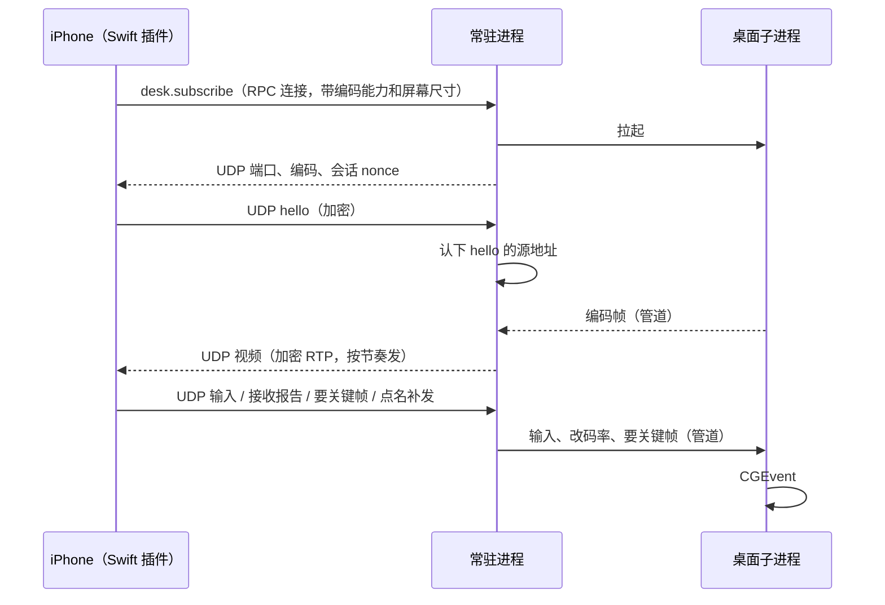

# 手机控制 Mac 桌面：决策记录

iPhone 看这台 Mac 的屏幕，并发送指针、滚轮和键盘。这里只记当初的取舍和还没做的事，最终行为以 `docs/features/mobile.md`「看 Mac 桌面」为准。

画面自己采集：ScreenCaptureKit 进 VideoToolbox，加密后走 UDP 到手机，手机原生层收包、解密、硬解。键鼠也走同一条 UDP。不连系统屏幕共享，不把 Open Screen Sharing 或 Moonlight 的代码引进来。配对过的手机就是授权，不再要 Mac 的登录密码。

## 进程

| 谁 | 做什么 |
| --- | --- |
| 桌面子进程 | 同一个已签名的 Posse 可执行文件（`posse desk helper`），由常驻进程拉起。跑 ScreenCaptureKit、编码器和 CGEvent 注入，屏幕录制和辅助功能两项授权都只用在这里。不听网络 |
| 常驻进程 | 决定订不订阅、加密、收发 UDP、码率调节，把手机的输入转给子进程。不调用 ScreenCaptureKit，避免 `replayd` 把录屏名额记在常驻进程上、停不掉 |
| 窗口 | 不采集。手机页显示谁在看（可以停掉）、缺哪一项授权 |
| 手机 | Swift 原生插件收 UDP、解密、拆 RTP、硬解，画到 Flutter 纹理上；Flutter 负责手势、视口和快捷键栏。订阅和退订走手机连着的那条 RPC 连接 |

子进程经 `internal/spawn`（`posix_spawn` 加私有的 `responsibility_spawnattrs_setdisclaim`）拉起，系统按它自己的签名（Posse.app 的包 ID 加证书）认授权。常驻进程本身也是这样拉起的，不管是窗口、终端里的 CLI 还是交接拉起，都记在 Posse 上。

授权要重启进程才生效：授权之后重新拉起子进程就行，常驻进程不用重启。

子进程和父进程之间两根管道：

- 子 → 父：编码后的帧（帧头加 Annex B 基本流），以及画面配置、状态（锁屏、缺授权）、屏幕列表、窗口列表。大约每秒一次心跳，静止画面也发。
- 父 → 子：控制和输入。要关键帧、改码率和帧率、输入事件、切屏或窗口、停止。

子进程读控制管道读到 EOF 就自己退出，不靠父进程发信号：常驻进程崩溃或交接退出时不留孤儿进程，菜单栏的录屏指示随之消失。

交接不带走桌面。旧进程退出时子进程跟着结束，交接记录和 `handoffVersion` 不动。手机本来就会重连，重连后重新订阅。

## 链路



## UDP 数据报

```
| 类型 1B | 计数器 8B | AES-256-GCM 密文 | 标签 16B |
```

- 密钥：材料是这条 RPC 连接两个方向的会话密钥，加订阅返回的会话 nonce，另做一次 HKDF（info `posse-desk/v1`），两个方向各一把。和 RPC 连接的收发密钥不同域；连接一断、退订或重新订阅，这组密钥作废。选 AES-GCM 是因为两端都有硬件 AES（Go 的 `crypto/aes`、iOS 的 CryptoKit）。
- nonce 是方向常量加计数器，类型字节进附加数据。
- 防重放用 1024 位滑动窗口（同 WireGuard 的做法）：乱序到达的包照收，重复的和落在窗口之前的丢掉。
- 单个数据报不超过 1200 字节，Tailscale 常见的 1280 MTU 不再拆包。

类型：

| 类型 | 方向 | 内容 |
| --- | --- | --- |
| hello（1） | 手机 → Mac | 订阅后立刻发，没收到视频每 100 ms 重发。Mac 只认解得开的 hello 的源地址，别人往端口发包引不走视频 |
| video（2） | Mac → 手机 | 一个 RTP 包（HEVC 按 RFC 7798，H.264 按 RFC 6184 拆），带帧号和采集时刻 |
| report（3） | 手机 → Mac | 每 100 ms 一次：收到的最高序号、丢包、排队延迟等。兼作保活 |
| input（4） | 手机 → Mac | 输入事件；必达事件带递增序号，没确认前每个包重复带上 |
| keyframe（5） | 手机 → Mac | 要关键帧 |
| beat（6） | Mac → 手机 | 每秒一次，带输入确认号和发出时刻；静止画面时手机靠它知道连接还活着 |
| nack（7） | 手机 → Mac | 点名要补发的视频包，明文是一串大端 u16 的 RTP 序号 |

手机的源地址变了（切网络）时，用新地址发来的、解得开的 hello 或 report 让 Mac 换过去。

## 采集和编码

- 编码器开 `RealTime`、关 `AllowFrameReordering`（没有 B 帧，帧一编完就能发），开 `EnableLowLatencyRateControl`：码率按帧平滑，不会某一帧突然很大堵住网络。
- 不定期插关键帧：周期关键帧比普通帧大好几倍，会定时卡一下。只在开始、手机要、恢复丢包时出关键帧。
- 像素只活在子进程里，从 SCK 到编码器不拷贝；常驻进程不解码，内存里不留位图，观看结束子进程退出。

## 之后

- 子进程 15 秒没有心跳就重启，一次观看最多重启 3 次，再失败就结束订阅，手机上写采集中断。现在心跳只在管道里发，常驻进程不检查。
- 放大到 1.5 倍以上时让 SCK 只采看得见的那块（`sourceRect`），同样的像素数看得更清楚。
- 触控板模式：手机上画本地光标，支持悬停。
- 丢包恢复用长期参考帧（LTR），少出关键帧。
