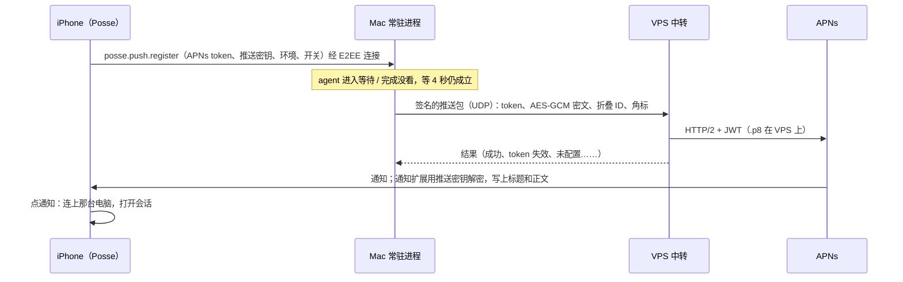

# 手机推送

App 在后台时，agent 等你处理、一轮完成没看，iPhone 收到通知，点开进到那个会话。只做 iOS（安卓国内收不到 FCM，后台长连接会被冻住，以后再看）。

## 路径

## 关键决策

- **谁发 APNs**：VPS 中转（`tools/deskrelay` 加 `--apns-key` 等参数）。.p8 只在 VPS 上，邀请的朋友的 Mac 也能推；Mac 用已有的中转密钥签名（同 `auth.go`），没配中转的 Mac 推不了，手机设置里说明。
- **内容加密**：手机安装时生成一把 32 字节推送密钥（存在 App Group，通知扩展读得到），注册时交给 Mac。Mac 用 AES-256-GCM 加密结构化的内容（种类、agent、项目、工作区、标签名、消息、电脑公钥、工作区 ID、终端 ID，见 `pushBody`），由通知扩展按 App 的界面语言写成标题和正文，中转和苹果只见密文。APNs 上的明文只有兜底文字（`loc-key`，扩展失败时显示「有会话需要你处理」）、`mutable-content`、角标数。
- **推送包**（UDP，一个包放得下）：`HRY1`、`0x07`、u8 标志（bit0 沙盒）、16 字节 nonce、u8 token 长度、token、16 字节折叠 ID、u16 角标、u16 密文长度、密文，接签名尾（时间、名字、签名）。回 `HRY1`、`0x87`、nonce、u8 结果。中转按 nonce 去重 11 分钟（盖住签名时间前后各 5 分钟的接受范围），Mac 1.5 秒没回执重发，最多 3 次，发完最后一次再等到 12 秒（中转等 APNs 最多 10 秒）。内容加密后超过 1100 字节时依次缩短消息、标签名、工作区名和项目名。手机按描述文件里的 `aps-environment` 报自己是否沙盒。结果 token 失效时 Mac 删掉这条注册。
- **什么时候推**：常驻进程里 agent 进入等待，或从工作中停下且记成没看（`noteStatus`）；等 4 秒还是这个状态、仍没看才推（桌面看着时窗口下一帧就报看过）。同一终端 30 秒内只推一次，折叠 ID 按终端，后一条替换前一条。
- **哪些手机不推**：这台手机此刻有连接开着、报过在前台、10 秒内收到过它的包（ping 5 秒一次，App 挂起后就停）；Mac 有人在用（HID 空闲不到 60 秒）时也不推，桌面通知够了。手机的开关（等待处理、完成）随注册交给 Mac。
- **角标**：推送带着待处理加没看的个数（同桌面 `badgeCount` 的口径）；App 在前台时按首页列表自己设。
- **一台手机多台电脑**：注册按手机安装 ID 存在 mobile.json（解除配对一起删）。手机每连上一台电脑就注册一次，所以连过的电脑都能推。点通知时按负载里的电脑公钥找到那台、切过去再打开会话。

## 步骤

1. `internal/deskrelay`：推送包编解码、去重、APNs 客户端（JWT ES256，标准库）；`tools/deskrelay` 加参数；单测用假 APNs。
2. Mac：`posse.push.v1`（`posse.push.register`、`posse.push.presence`）、注册存盘、发送器（物理网卡 socket）、常驻进程的触发和节流；单测。
3. iOS：entitlements（aps-environment、App Group），通知扩展 target，AppDelegate 注册 token、处理点击，原生通道 `posse/push`。
4. Flutter：申请权限、注册、前后台上报、点击打开会话、设置页开关和状态、角标；l10n。
5. 文档 `docs/features/mobile.md`，部署中转，真机验收。

## 需要用户做的

- 开发者后台生成 APNs 密钥（.p8）并告诉我 Key ID，传到 VPS。
