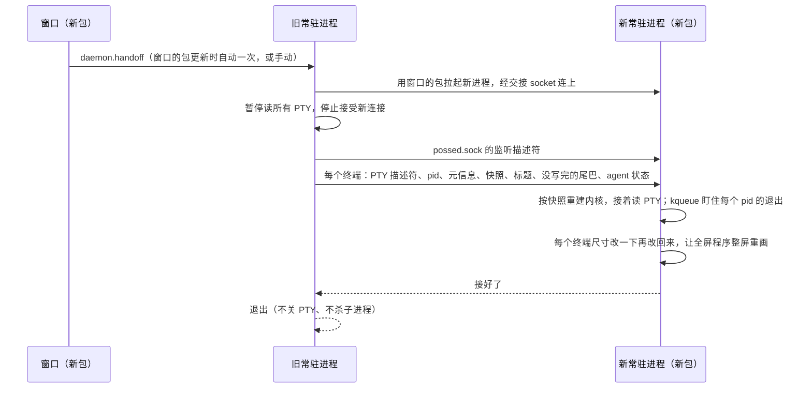

# 升级时不断终端：常驻进程接力交接

升级时由新包启动的常驻进程把旧进程整个接过去：PTY 描述符、子进程、屏幕状态、监听 socket 都交过去，旧进程退出，终端里的程序照常运行。

没选"拆出常驻的终端宿主"（Orca、VS Code 的做法，iTerm2 则用只持有 PTY 描述符的 `iTermServer`）：宿主不重启，终端层（`internal/term`、`internal/vt`）的修复到不了正在跑的终端；还要多一个常驻进程（违背低内存），状态分在两个进程里，控制进程重启时 hook、权限审批、`task wait` 会丢。交接只在升级那一下复杂，平时还是一个进程，整个进程都换成新代码。

## 流程



## 触发与协议约定

- 触发时机：窗口的包比常驻进程新时在轮询里自动触发一次（`internal/app/upgrade.go` 的 `autoUpgrade`，包新旧按构建标识里的时间比，每个常驻进程 pid 只自动试一次；已接受操作未完成返回 `busy` 时延迟重试），设置页「关于」的"更新常驻进程"和 `posse daemon handoff` 手动触发。旧进程用调用方给的可执行文件路径拉起新进程；交接失败时旧进程恢复读 PTY 照常运行、报错给调用方，断终端的重启只留作兜底。
- 交接不变量（`internal/daemon/handoff.go`）：
  - 协议版本是 `handoffVersion`：改了交接记录或帧格式、新旧两边解析不了时要加一（旧进程只认版本号相等的新进程，加了就要重启一次才能升上来）；新旧双向都能解析的可选字段（如 `handoffTerm.Runtime`）不加。
  - 新建终端和交接开始经 `handoffState.startMu` 互斥；交接的终端和以它们为 worker 的任务不记为 `lost`。ZCode 尚未粘贴的首条提示以任务 ID 交接，由接手的进程继续等输入区就绪。
  - 旧进程只把 PTY 已交出去的终端的退出留给新进程；交接窗口里退出的终端新进程收不到退出码，记 `-1`。
  - 新进程回话后马上用旧进程交来的 socket 开始服务（hook 只等 2 秒，不能等旧进程退出），先写 pid 文件，在后台一直等 `$POSSE_HOME/possed.lock`，拿到才开手机服务（端口在旧进程手里），等不到也不退出；普通启动拿到锁后若 socket 还有人应答就退出，免得交接空档里被拉起的进程删掉新进程的 socket。
  - 交接期间 `terminal wait --for idle` 不算空闲；手机看着时终端是手机的尺寸，记录里带上界面的尺寸（`DeskCols`、`DeskRows`），新进程换回去。
- 退出与长等待（交接或重启）：`rpc.Server` 先等正在处理的请求写完回复（最多 3 秒），处理函数因请求的 ctx 结束返回 `context.Canceled` 的回成 `restarting`。新增长等待的 RPC 要跟着 ctx 结束，CLI 侧走 `doWait`，到新进程上按剩下的时间接着等；`task ask` 带回问题 ID 改成 `--resume`、Claude 权限挂起到新进程上再挂，见 `doWait` 和 `hook.permission.hold` 调用处的注释。

## 带不过去的终端状态

保存的光标位置（`ESC 7`/`CSI s`，Claude 会用）、kitty 键盘协议的多层设置（只带最上一层）、改过的调色板和前景色（OSC 4/10）。靠交接后改一下尺寸让程序整屏重画补救。窗口每次接入用的是同一份快照，这些限制本来就存在。

滚动区域、线框字符集、制表位、光标形状、kitty 键盘单层、modifyOtherKeys、键盘应用模式、光标键模式、SGR 鼠标、自动换行、原点模式、插入模式、当前画笔都能带过去。

快照重放时保留软换行，包含宽字符在行尾放不下移到下一行、续行首格被擦除的情况。这样接入端复制选区时能接回同一逻辑行，改宽度也能重排这一行。

## 从副本运行

常驻进程不从 Posse.app 运行，从它的 APFS 克隆副本运行（`internal/spawn/runtime.go`）。终端里的进程对授权的负责进程是拉起它们的常驻进程，tccd 按那个常驻进程的程序路径核实身份。实测（PosseDev，2026-10-28，`log stream` 看 tccd 的 `AUTHREQ_ATTRIBUTION`）：

- 常驻进程交接退出后，路径上换成了同一证书签的新包：照常放行（`responsible_path` 指向新包）。
- 常驻进程还活着时包被换掉：这期间终端访问桌面被拒，交接后仍一直被拒。
- 路径上的文件被删掉：没有 `responsible_path`，按 `/bin/ls` 这类系统程序认，拒绝。
- 克隆到别处的副本（同包 ID、同证书）沿用已有的授权，不弹框。

所以副本按构建分目录、永不原地改写，拉起过终端的副本等这些终端全部退出才删：

```
~/Library/Application Support/Posse/runtime/<包ID>/
  .lock                          创建、登记、回收时持有
  <版本>-<修改时间>-<哈希>/
    Posse.app                    clonefile 克隆（跨卷时 ditto）
    refs/<home 的哈希>            这个 POSSE_HOME 还在用（放在 .app 外面，不破坏签名）
```

- 拉起常驻进程的各方都先准备副本（同一构建复用）并登记 home：`client.EnsureDaemon`、交接时的旧进程，以及调 `daemon.handoff` 的窗口（自动交接、手动更新、自动更新）和 `posse daemon handoff`。旧版本的旧进程不会自己做副本，调用方准备好再把副本路径交给它，从旧版本升上来的这次也从副本运行。准备不了就从原包运行，不挡启动和交接。
- 每个终端记着拉起它的副本（`session.runtime`），交接记录里带过去（`handoffTerm.Runtime`，可选字段，没加 `handoffVersion`，旧版本交来的为空、不参与回收）。
- 回收在常驻进程启动时和终端退出后做：自己的副本和还有活终端的副本保留，其余去掉本 home 的登记；刚登记不到一分钟的不动（调用方准备好副本、常驻进程还没起来）；没有任何登记、也没有进程从里面运行的，先改名再删。
- 终端里长期留着的 posse 路径（hooks 命令、statusLine、`$POSSE_HOME/bin` 的转发脚本）写 `$POSSE_HOME/bin/posse`，每个常驻进程启动时原子地指向自己：旧终端里后来手动启动的 agent 用的是当时的常驻进程，那份副本可能先被回收。PATH 最前面仍是拉起终端的副本目录，终端活着它就在。
- 带不过去的：从终端里脱离出去、比终端活得久的后台进程，副本删掉后它们访问桌面会被拒；`go build` 的 bin/posse 不复制，照旧。窗口进程仍从原包运行，换包后照旧提示重开（`relaunch.go`）。
