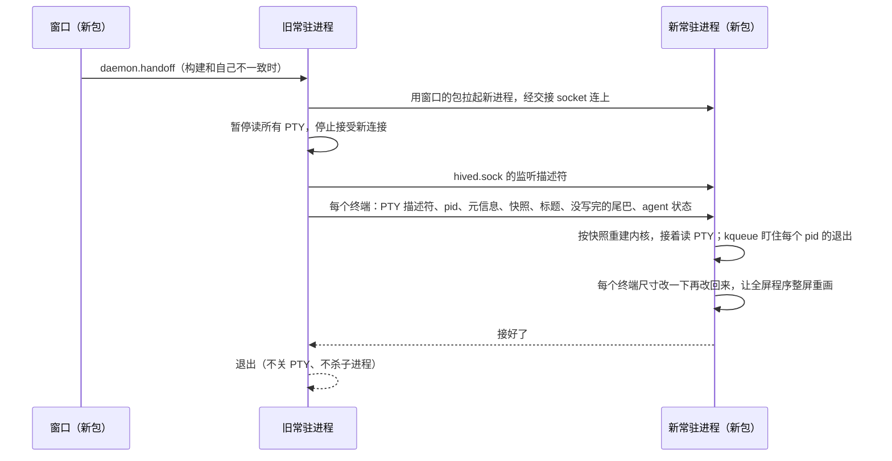

# 升级时不断终端：常驻进程接力交接

现在每次改常驻进程都要重启它，重启就断掉所有终端。改成升级时由新包启动的常驻进程把旧进程整个接过去：PTY 描述符、子进程、屏幕状态、监听 socket 都交过去，旧进程退出，终端里的程序照常运行。

没选"拆出常驻的终端宿主"（Orca、VS Code 的做法，iTerm2 则用只持有 PTY 描述符的 `iTermServer`）：宿主不重启，终端层（`internal/term`、`internal/vt`）的修复到不了正在跑的终端；还要多一个常驻进程（违背低内存），状态分在两个进程里，控制进程重启时 hook、权限审批、`task wait` 会丢。交接只在升级那一下复杂，平时还是一个进程，整个进程都换成新代码。

## 流程

## 已验证（2026-10-18，脚本和录制在 `/tmp/handoff-spike`）

- PTY 主端描述符经 unix socket（SCM_RIGHTS）交给另一个进程后，原进程退出，shell 被 launchd 接管照常运行，新进程能接着读写。
- kqueue `EVFILT_PROC` 加 `NOTE_EXIT|NOTE_EXITSTATUS` 对已经不是自己子进程的 pid 也给出退出状态：正常退出拿到退出码，被信号杀掉拿到信号号（Apple 文档写只对子进程有效，实测可用；拿不到时记为"已退出"）。
- 快照重建：在真 PTY 里录 vim、less、top、带颜色的 shell、Claude Code 的输出，1905 个交接点（全部读取块边界加每个程序随机 300 个字节位置），比较 `VT()` 格式化输出、可见屏幕格子、回滚区文字、标题、鼠标和 17 个模式，补上下面两处后交接时和之后全部一致：
  - 快照不带窗口标题，交接时单独带过去；
  - 读到的块可能切在转义序列或 UTF-8 字符中间，末尾没写完的原始字节（`safeCut` 之后的部分）随快照交过去，新进程先喂快照再喂它。
- 带不过去的状态：保存的光标位置（`ESC 7`/`CSI s`，Claude 会用）、kitty 键盘协议的多层设置（只带最上一层）、改过的调色板和前景色（OSC 4/10）。靠交接后改一下尺寸让程序整屏重画补救（未实测）。窗口每次接入用的是同一份快照，这些限制本来就存在。
- 已核实交接前后一致的：滚动区域、线框字符集、制表位、光标形状、kitty 键盘单层、modifyOtherKeys、键盘应用模式、光标键模式、SGR 鼠标、自动换行、原点模式、插入模式、当前画笔。
- TCC：用证书签名后，包被替换时旧常驻进程以前开的和现在新开的程序都能读桌面和文稿。

## 决策

- 交接在 `internal/host` 的边界上做：每个终端导出一份交接记录（元信息、快照、标题、尾巴、agent 状态、hooks 标记）加 PTY 描述符，新进程按记录重建 `host.Terminal`。交接期间旧进程停读 PTY，内核缓冲替程序攒着输出。
- 监听描述符一起交过去，socket 文件不删不重建，旧进程停接新连接之后新进程马上接，没有停机空档。正在进行的长连接（窗口接入流、手机、`task wait`、`terminal wait`）随旧进程断开：窗口和手机本来会重连，CLI 的长等待加重试。
- 子进程不再是新进程的子进程：退出改用 kqueue 盯 pid，PTY 读到 EOF 同样算结束。
- 只有新包发起交接（`daemon.handoff` 由窗口在构建不一致时调用，设置页"重启常驻进程"改成"更新常驻进程"），旧进程用调用方给的可执行文件路径拉起新进程。交接失败（新进程起不来、超时、协议不认）时旧进程恢复读 PTY 照常运行，报错给窗口；断终端的重启只留作兜底。
- 交接协议带版本号，新进程认不出旧记录就拒绝，旧进程继续运行。
- 锁：旧进程持有 `hived.lock` 到退出。新进程回话后立刻在接过来的监听上服务，后台等锁，拿到锁才开手机服务；pid 文件回话后由新进程改写，旧进程交出去之后不删。
- 交接窗口里退出的程序：旧进程已经收走它，新进程的 kqueue 注册不上，退出码记 -1。

## 步骤

1. 交接原型（已完成）：终端交接记录的导出和重建、PTY 描述符传递、kqueue 盯退出、尾巴和标题、监听 socket，`hive daemon handoff` 手动触发。独立 `HIVE_HOME` 里实测：shell 回滚文字、less 画面交接前后一致；一边每 20ms 输出一行一边交接，400 行不丢不重；交接后 shell、vim 照常输入保存；交接后才退出的程序退出码（4、5）对；已结束的终端带着屏幕和退出码过去；agent 状态和会话 ID 保留；连续交接两次；新进程起不来时旧进程恢复，终端照常用。改尺寸重画的效果：vim 底部的文件信息行被重画清掉，Claude 用经典渲染时重画后顶部的提示行不见了，都是程序自己按新尺寸重画的结果。
2. 长等待不断（已完成）：常驻进程退出前等请求写完回复，被打断的长等待回 restarting，CLI 换到新进程接着等；`task ask` 改成 resume，不重复提问；权限挂起由 hook 重挂；手机看着时的终端换回界面尺寸。实测 `terminal wait`、`task ask`、`task wait` 都在等待中经历交接后拿到结果，问题只有一条，任务保持 running。权限挂起的重挂没有接手机实测。
3. 升级流程（已完成）：窗口的包比常驻进程新时自动交接（按常驻进程 pid 只试一次），设置页构建不一致时主按钮是"更新常驻进程"，失败报在错误条上；旧常驻进程不认 `daemon.handoff` 时退回"重启常驻进程"。实测：旧二进制起的常驻进程在打开新打的 Hive.app 后几秒内被交接，终端照常输出；用旧二进制手动交接回去后窗口马上又换回新包；照窗口的方式接入终端，交接时连接结束且不算程序退出，重新接入拿到新进程的快照和输出；d094628 的常驻进程（没有交接能力）不被打扰，窗口照常接入终端。屏幕锁着，没有截图看窗口画面。
4. 切换：现在跑着的常驻进程还没有交接能力，只有这一次要用老办法重启。
