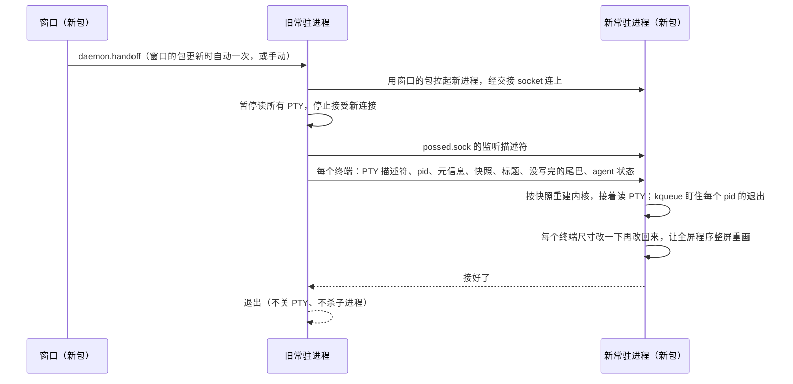

# 升级时不断终端：常驻进程接力交接

升级时由新包启动的常驻进程把旧进程整个接过去：PTY 描述符、子进程、屏幕状态、监听 socket 都交过去，旧进程退出，终端里的程序照常运行。

没选"拆出常驻的终端宿主"（Orca、VS Code 的做法，iTerm2 则用只持有 PTY 描述符的 `iTermServer`）：宿主不重启，终端层（`internal/term`、`internal/vt`）的修复到不了正在跑的终端；还要多一个常驻进程（违背低内存），状态分在两个进程里，控制进程重启时 hook、权限审批、`task wait` 会丢。交接只在升级那一下复杂，平时还是一个进程，整个进程都换成新代码。

## 流程

## 触发

窗口的包比常驻进程新（按构建标识里的时间比）时，窗口在轮询里自动发起一次（`internal/app/upgrade.go`，按常驻进程 pid 只试一次）；设置页「关于」的"更新常驻进程"按钮手动发起；命令行是 `posse daemon handoff`。旧进程用调用方给的可执行文件路径拉起新进程。交接失败时旧进程恢复读 PTY 照常运行，报错给调用方；断终端的重启只留作兜底。

锁、退出码、长等待、协议版本等细节见根目录 AGENTS.md 的"升级交接"和"常驻进程退出"两条。

## 带不过去的终端状态

保存的光标位置（`ESC 7`/`CSI s`，Claude 会用）、kitty 键盘协议的多层设置（只带最上一层）、改过的调色板和前景色（OSC 4/10）。靠交接后改一下尺寸让程序整屏重画补救。窗口每次接入用的是同一份快照，这些限制本来就存在。

滚动区域、线框字符集、制表位、光标形状、kitty 键盘单层、modifyOtherKeys、键盘应用模式、光标键模式、SGR 鼠标、自动换行、原点模式、插入模式、当前画笔都能带过去。
