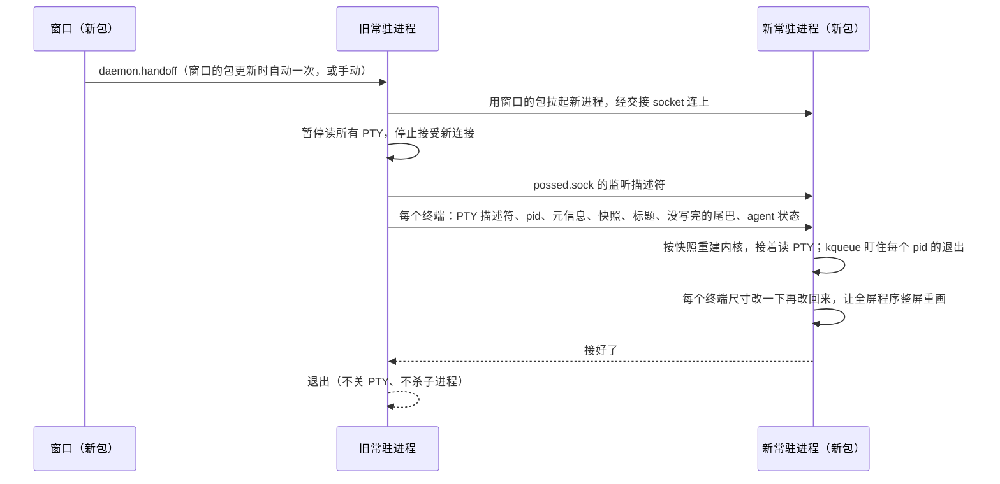

# 升级时不断终端：常驻进程接力交接

升级时由新包启动的常驻进程把旧进程整个接过去：PTY 描述符、子进程、屏幕状态、监听 socket 都交过去，旧进程退出，终端里的程序照常运行。

没选"拆出常驻的终端宿主"（Orca、VS Code 的做法，iTerm2 则用只持有 PTY 描述符的 `iTermServer`）：宿主不重启，终端层（`internal/term`、`internal/vt`）的修复到不了正在跑的终端；还要多一个常驻进程（违背低内存），状态分在两个进程里，控制进程重启时 hook、权限审批、`task wait` 会丢。交接只在升级那一下复杂，平时还是一个进程，整个进程都换成新代码。

## 流程



## 触发

自动和手动触发见根目录 AGENTS.md 的"升级交接"；锁、退出码、长等待、协议版本等细节见同处和"常驻进程退出"。补充：包新旧按构建标识里的时间比，自动触发由窗口在轮询里发起，按常驻进程 pid 只试一次；手动按钮在设置页「关于」。旧进程用调用方给的可执行文件路径拉起新进程。交接失败时旧进程恢复读 PTY 照常运行，报错给调用方；断终端的重启只留作兜底。

## 带不过去的终端状态

保存的光标位置（`ESC 7`/`CSI s`，Claude 会用）、kitty 键盘协议的多层设置（只带最上一层）、改过的调色板和前景色（OSC 4/10）。靠交接后改一下尺寸让程序整屏重画补救。窗口每次接入用的是同一份快照，这些限制本来就存在。

滚动区域、线框字符集、制表位、光标形状、kitty 键盘单层、modifyOtherKeys、键盘应用模式、光标键模式、SGR 鼠标、自动换行、原点模式、插入模式、当前画笔都能带过去。

## 从副本运行

常驻进程不从 Posse.app 运行，从它的 APFS 克隆副本运行（`internal/spawn/runtime.go`）。终端里的进程对授权的负责进程是拉起它们的常驻进程，tccd 按那个常驻进程的程序路径核实身份。实测（PosseDev，2026-10-28，`log stream` 看 tccd 的 `AUTHREQ_ATTRIBUTION`）：

- 常驻进程交接退出后，路径上换成了同一证书签的新包：照常放行（`responsible_path` 指向新包）。
- 常驻进程还活着时包被换掉：这期间终端访问桌面被拒，交接后仍一直被拒。
- 路径上的文件被删掉：没有 `responsible_path`，按 `/bin/ls` 这类系统程序认，拒绝。
- 克隆到别处的副本（同包 ID、同证书）沿用已有的授权，不弹框。

所以副本按构建分目录、永不原地改写，拉起过终端的副本等这些终端全部退出才删：

```
~/Library/Application Support/Posse/runtime/<包ID>/
  .lock                          创建、登记、回收时持有
  <版本>-<修改时间>-<哈希>/
    Posse.app                    clonefile 克隆（跨卷时 ditto）
    refs/<home 的哈希>            这个 POSSE_HOME 还在用（放在 .app 外面，不破坏签名）
```

- 拉起常驻进程的各方都先准备副本（同一构建复用）并登记 home：`client.EnsureDaemon`、交接时的旧进程，以及调 `daemon.handoff` 的窗口（自动交接、手动更新、自动更新）和 `posse daemon handoff`。旧版本的旧进程不会自己做副本，调用方准备好再把副本路径交给它，从旧版本升上来的这次也从副本运行。准备不了就从原包运行，不挡启动和交接。
- 每个终端记着拉起它的副本（`session.runtime`），交接记录里带过去（`handoffTerm.Runtime`，可选字段，没加 `handoffVersion`，旧版本交来的为空、不参与回收）。
- 回收在常驻进程启动时和终端退出后做：自己的副本和还有活终端的副本保留，其余去掉本 home 的登记；刚登记不到一分钟的不动（调用方准备好副本、常驻进程还没起来）；没有任何登记、也没有进程从里面运行的，先改名再删。
- 终端里长期留着的 posse 路径（hooks 命令、statusLine、`$POSSE_HOME/bin` 的转发脚本）写 `$POSSE_HOME/bin/posse`，每个常驻进程启动时原子地指向自己：旧终端里后来手动启动的 agent 用的是当时的常驻进程，那份副本可能先被回收。PATH 最前面仍是拉起终端的副本目录，终端活着它就在。
- 带不过去的：从终端里脱离出去、比终端活得久的后台进程，副本删掉后它们访问桌面会被拒；`go build` 的 bin/posse 不复制，照旧。窗口进程仍从原包运行，换包后照旧提示重开（`relaunch.go`）。
